# 02 — Aéraulique : perçage, film d'air, crantage, chaîne ventilateur → plaque

> Lot aéraulique, version du 2026-11-04. Calculs : `calc/aero/` (chaîne complète
> `python3 -m calc.aero.run_all`, ≈ 6 min sur 4 cœurs, chaque étape < 5 min).
> Résultats : `calc/aero/results/*.json` ; valeurs à fusionner :
> `calc/aero/results/recommended_params.toml` (`params/design.toml` n'est pas modifié).
> Légende : **[V]** vérifié par deux méthodes ; **[P]** provisoire / ordre de grandeur.

## 0. Synthèse

| Grandeur | Valeur retenue | Baseline (design.toml) |
|---|---|---|
| Orifice | **Ø0,30 ± 0,005 mm, voile L = 1,20 ± 0,05 mm** | Ø0,40 ± 0,01, L = 1,0 |
| Maille | **hexagonale, pas 5,00 mm** (≈ 6 000 trous sur 360 × 360) | hex 5 |
| Perçage borgne d'alimentation | Ø2,0 (paroi 3 mm), profondeur e − 1,2 | Ø2,0 |
| Entrefer cible | **dépend de la masse** : h = 130,2 − 24,8·ln(m[g]) borné à [80 ; 140] µm → 113 µm (2 g), 90 µm (5 g), 80 µm (≥ 7,5 g) | 120 µm fixe |
| Pression plenum (consignes) | 65,5 Pa (2 g) → 265 Pa (10 g) ; enveloppe 57–297 Pa | 30–400 Pa |
| Débit total (trous libres + fuites) | 6,5 → 20,0 m³/h | ≈ 13–46 m³/h |
| Spécification ventilateur (marges ×1,15, filtre colmaté) | **max 23,1 m³/h sous 375 Pa ; min 5,7 m³/h sous 53 Pa** | — |
| Ventilateur | San Ace 9BMC24P2G001 validé (≈ 42 % PWM au point max) **avec vanne de décharge à deux états** | TBD |
| Crantage (pente équivalente, pire masse 10 g) | **33 µrad RMS, 57 µrad crête**, moyenne nulle (enveloppe des modèles 27–62 µrad RMS) | 90 µrad RMS, 185 crête |
| Dispersion des orifices (±0,005 mm) | 5–8,5 µrad RMS (aléatoire) | — |

Points clés :

1. **Le crantage est le terme dominant du budget de pente côté aéraulique.** Avec la
   configuration retenue il vaut ≈ 33 µrad RMS (57 µrad crête) pour le palet de 10 g,
   25–29 µrad RMS pour 2–7,5 g. Il est **périodique, de moyenne nulle et conservatif à
   95 %**. La table caractérise les palets sans compensation en ligne ; c'est donc une
   **erreur de mesure** de 0,5–3 µN RMS (§ 11), corrigeable seulement a posteriori (gain ≈ 2).
2. Le passage de Ø0,40 à **Ø0,30 mm** et l'**entrefer cible dépendant de la masse** (les
   palets lourds volent plus bas, car la poussée de quantité de mouvement du film croît
   comme q²) divisent le crantage par ≈ 2,7 par rapport à la baseline, à nombre de trous égal.
3. Le candidat de la reprise précédente (hex 2,94 mm, ≈ 17 300 trous) donne **le même
   crantage** (33–35 µrad RMS) une fois l'entrefer adapté à la masse ; selon le critère
   d'origine (départage par le débit puis le nombre de trous) le pas de **5 mm** l'emporte :
   débit ÷ 2,3, trous ÷ 2,9, plaque plus rigide (porosité 14,5 % au lieu de 24–42 %).
4. Les **pas « magiques »** (4,23 / 4,82 mm) n'annulent que le basculement ; la poussée de
   quantité de mouvement s'y ajoute au lieu de s'y opposer : 56–65 µrad RMS (Ø0,30), plus
   mauvais que hex 5. Leur minimum est en outre étroit (§ 6.4). Comparaison informative.
5. Le ventilateur 9BMC est **largement surdimensionné en pression** (×4,6 au point max) ;
   il ne descend pas au point bas par la seule vitesse (il faudrait n ≈ 0,18, sous le plancher
   PWM) ⇒ **vanne de décharge nécessaire**. Alternative mieux adaptée : 9BMB24P2G01 (§ 9.4).

## 1. Hypothèses et données

- Air à 20 °C : ρ = 1,204 kg/m³, μ = 1,81·10⁻⁵ Pa·s (`params/design.toml`).
- Palets Ø30 mm, 2 à 10 g, face inférieure plane (5 µm), hauteur supposée 10 mm
  (inertie de basculement, traînée des courants d'air).
- Zone percée 360 × 360 mm, zone de travail 300 × 300 (le palet reste à ≥ 15 mm du bord percé).
- Restriction **en face supérieure** (orifice dans le voile, perçage borgne d'alimentation
  par-dessous) : volume aval minimal (pas de marteau pneumatique, § 8).
- Plaque : épaisseur 25 mm dans les calculs (`design.toml`) ; le lot structure propose 35 mm :
  perte supplémentaire du perçage Ø2 × 34 mm ≈ 0,5 % du débit, sans effet sur le crantage.
- Budget de pente : ≤ 50 µrad crête, objectif 20 µrad (`docs/00_cahier_des_charges.md`).
  Une force latérale parasite F est exprimée en **pente équivalente** F/(m g).

## 2. Loi débit-pression d'un trou (`orifice.py`) [V]

Modèle de référence : corrélation de Lichtarowicz, Duggins & Markland (1965) pour tubes
courts à entrée vive (2 ≤ L/d ≤ 10) :

    1/Cd = 1/Cd_u + 20·(1 + 2,25 L/d)/Re_th ,   Cd_u = 0,827 − 0,0085 L/d ,
    Re_th = d·√(2Δp/ρ)/ν ,   q = Cd·A·√(2Δp/ρ)

en série avec le perçage borgne (Poiseuille + entrée) et, sous un palet, la perte
« rideau » K_c·ρ/2·(q/(π d h))² (K_c = 0,5). Recoupée par un modèle analytique (Shah 1978 :
développement laminaire + ζ_entrée + énergie de sortie). Écart entre modèles à Δp donné :
−12 % (Shah, arête vive) à +8 % (modèle K = 1,5 de la pré-étude).

| Ø0,30 / L1,2 (retenu) | 65 Pa (2 g) | 139 Pa (5 g) | 265 Pa (10 g) |
|---|---|---|---|
| débit d'un trou libre q (mm³/s) | 329 | 558 | 851 |
| vitesse de jet V (m/s) | 4,7 | 7,9 | 12,0 |
| Re = V d/ν | 93 | 158 | 241 |
| Cd | 0,45 | 0,52 | 0,57 |

Sensibilités (Ø0,30, régime bas Re) : q ∝ d^2,7…3,0 et q ∝ L^−0,34…−0,49 (exposants du
Monte-Carlo, § 7) ; entrée conique (pointe 118° du perçage Ø2) +6 % ; **bavure obstruant
10 % / 25 % de l'entrée : −6 % / −18 %** ; chanfrein de sortie 0,05 mm : +0,8 % ;
compressibilité négligeable (Mach 0,04). Figures :
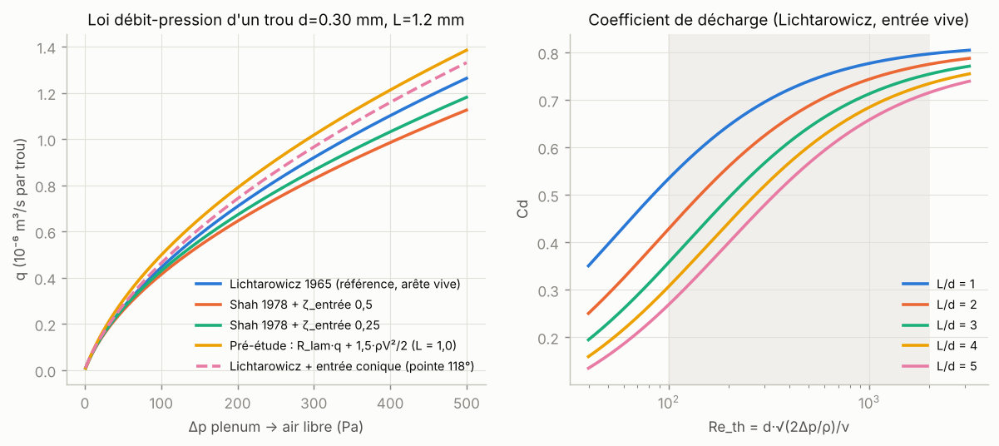
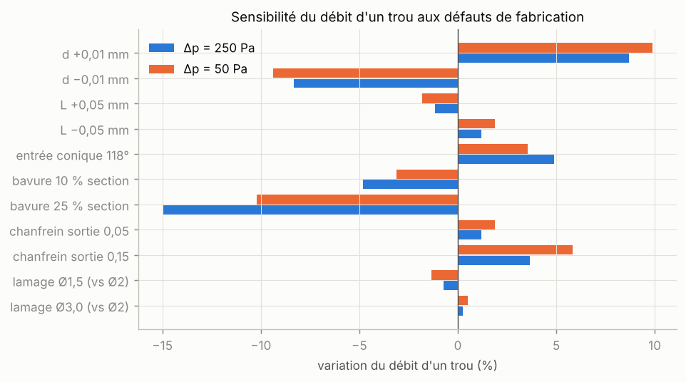

## 3. Film d'air sous le palet (`film.py`) [V]

Équation de Reynolds stationnaire incompressible, film mince :

    ∇·( h³/(12μ) ∇p ) = − Σ_i q_i δ(x − x_i)     sur le disque r < R,  p(R) = 0
    ps − p_i = Δp_trou(q_i) + K_c·ρ/2·(q_i/(π d h_i))²

Trois modèles implantés et recoupés :

1. **axisymétrique homogénéisé** avec correction « de puits » (Peaceman)
   p_trou − p̄ = 6μq/(π h³)·[ln(r_e/r_h) − 3/4] — sans elle, la portance est surestimée de
   ≈ 11 % ; sert à W(h, ps), k_z, k_θ (mode m = 1 linéarisé) ;
2. **discret exact** pour film parallèle : fonction de Green du disque (images), portance et
   moment en forme close W = 12μ/h³ Σ q_i (R² − ρ_i²)/4, M = 12μ/h³ Σ q_i ξ_i (R² − ρ_i²)/8 ;
3. **différences finies 2D** (Shortley–Weller, singularités soustraites) pour film incliné
   h = h0 + a x + b y : k_θ exact et équilibre complet (h0, a, b).

Écarts : DF ↔ Green 0,04 % sur W, 0,5 % sur M ; homogénéisé ↔ moyenne discrète 0,1–0,2 %
(ps discret/ps axi = 0,998–1,000, `setpoints.json`) ; k_θ homogénéisé ↔ DF 1–4 %.
**Équilibre complet DF validé** contre la linéarisation θ = M/k_θ (`cogging.json`,
`fd_validation`) : h à 0,1 µm près, basculement à 1–5 % près ; balourd e = 100 µm :
DF −166,1 / linéarisé −165,9 µrad (10 g).

**Force latérale d'un palet basculé** : pression normale (−W·α) + cisaillement de Poiseuille
(+½ W·α) ⇒ F = −½·W·α, soit une pente équivalente α/2 (exact en lubrification).

**Balourd** : k_θ/W = 0,52–0,58 m ⇒ **0,86–0,96 µrad de pente équivalente par µm de
décentrage du centre de gravité** (10 g → 2 g). Un décentrage de 0,1 mm vaut ≈ 90 µrad :
les palets doivent être équilibrés (≤ 5 µm), ou leur balourd étalonné et retranché en post-traitement (§ 11.4).

## 4. Crantage : mécanismes (`film.py`, `cogging.py`)

La position du palet dans le réseau de trous modifie la répartition des sources sous lui :

1. **basculement** induit par l'asymétrie de portance : θ = M/k_θ, pente équivalente θ/2 ;
   la composante dominante (premier anneau du réseau réciproque) s'annule pour |G₁|·R = j₃,ₖ
   (zéros de J₃) : **pas « magiques »** p = 4πR/(√3 j₃,ₖ) en hex = 2,84 / 3,09 / 3,39 / 3,76 /
   4,23 / 4,82 mm ;
2. **poussée de quantité de mouvement du film** : les trous proches du bord « soufflent »
   sous l'arête ; flux 1,2 ρ q_n²/h au bord (profil de Poiseuille), part ½ sur le palet
   (symétrie du film). Croît comme q² (donc avec ps et la masse) et dépend peu du pas.
   Régularisation près du bord δ_min = max(d, 2h) : incertitude ≈ ×2 (variantes ×0,5/×2) **[P]** ;
3. jets de bord (déviation par l'arête, Coanda) : estimation séparée β = 0,1, 3–14 µrad **[P]**.

Les deux premiers termes sont des vecteurs ; leur somme peut se compenser partiellement.
C'est le cas au pas 5 (et au pas 2,94) avec Ø0,30 ; c'est l'inverse aux pas magiques.

## 5. Optimisation du perçage (`optimize.py`) [V modèle]

- Grille : d ∈ {0,30 ; 0,35 ; 0,40 ; 0,45} mm, L ∈ {0,8 … 2,0} mm, mailles hex et carrée,
  pas 3,0–6,0 mm + pas magiques ; contraintes d ≥ 0,30 mm, voile ≥ 0,8 mm, L/d ≤ 4,
  ≥ 30 trous sous le palet, ps(10 g, h = 80 µm) ≤ 400 Pa, 0,9·ps(2 g, h = 120 µm) ≥ 30 Pa.
- Étape B : crantage (modèle discret, cellule échantillonnée 7 × 7) **à l'entrefer optimal de
  chaque masse** (2 g : 100–140 µm ; 5 g : 80–120 ; 10 g : 80–100) ; critère
  J = max_m (pente équivalente RMS).
- Étape C : présélection J ≤ 1,15·J_min, grille d'entrefer fine, variantes de modèle
  (δ_min ×0,5, bord abrupt) ; **critère d'origine** : J minimal, départage parmi
  J ≤ 1,1·J_min par le débit total puis le nombre de trous.
- Étape D : affinage du pas ±0,1 mm (pas de 0,025), cote ronde préférée si équivalente.

Résultat : **hex 5,00 mm, Ø0,30, L1,20 : J = 32,7 µrad** (étape C : enveloppe des variantes
62 µrad). Le pas est un minimum modéré : 4,95 → 41, 5,025 → 34, 5,1 → 39 µrad (figure
`optim_affinage_pas.png`). Figures : `optim_pareto.png`, `optim_crantage_vs_pas.png`.

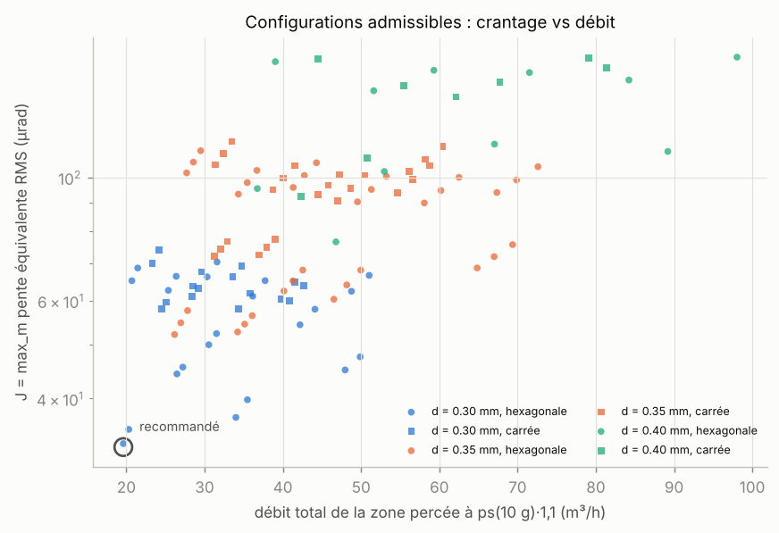
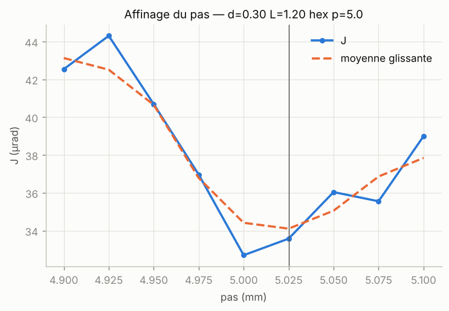

### 5.1 Loi d'entrefer cible h(m) (`setpoints.py`)

Pour chaque masse, minimum de J(h) sur h ∈ [70 ; 140] µm sous la contrainte h ≥ 80 µm
(cahier des charges), puis lissage affine en ln m :
**h = 130,2 − 24,8·ln(m[g]) µm, borné à [80 ; 140]**. Le crantage sur la loi vaut
25,0 / 25,2 / 25,9 / 26,8 / 27,7 / 28,8 / 32,7 µrad RMS pour 2 / 3 / 4 / 5 / 6 / 7,5 / 10 g.
Les palets ≥ 7,5 g sont en butée à 80 µm : c'est la limite basse du cahier des charges qui
fixe leur crantage (à 70 µm le gain serait encore de ≈ 10 %).

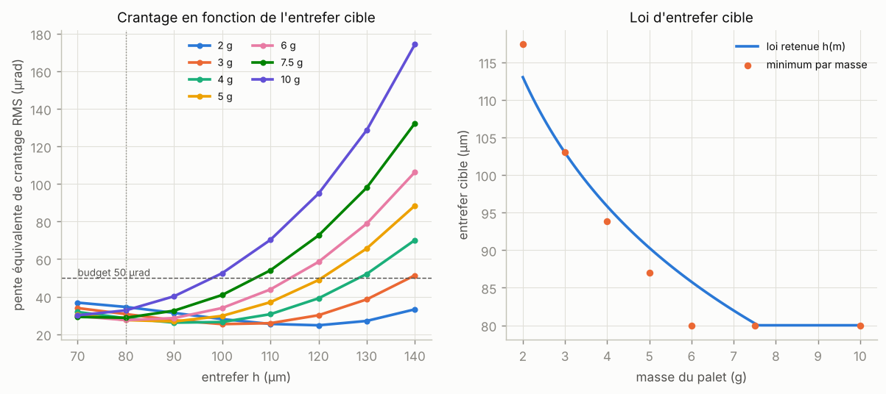

## 6. Crantage de la configuration retenue (`cogging.py`)

### 6.1 Cartes sur la cellule

| Masse | h (µm) | ps (Pa) | pente RMS (µrad) | crête (µrad) | Δh c-à-c (µm) | ΔW/W c-à-c |
|---|---|---|---|---|---|---|
| 2 g | 113 | 66 | 25,5 | 48 | 2,0 | 2,1 % |
| 5 g | 90 | 139 | 27,6 | 54 | 2,4 | 2,3 % |
| 10 g | 80 | 266 | 33,8 | 61 | 2,5 | 2,3 % |
| baseline 10 g (Ø0,40, h 120) | 120 | 304 | 167 | 324 | 2,0 | 1,9 % |

(cellule 16 × 16 ; l'étape C de l'optimisation, 10 × 10, donne 32,7 µrad à 10 g.)
La moyenne du vecteur pente sur la cellule est **nulle** (symétrie du réseau) : un palet
qui traverse plusieurs cellules ne subit aucune dérive moyenne.

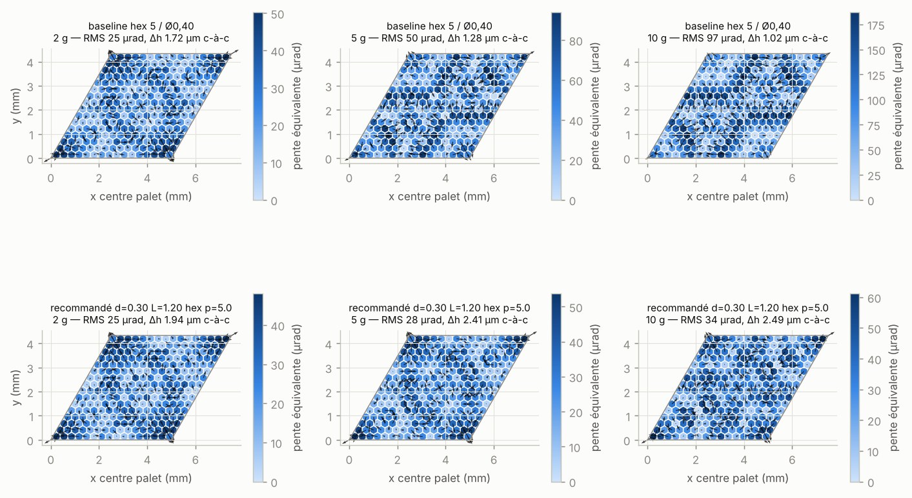

### 6.2 Crantage en fonction du pas

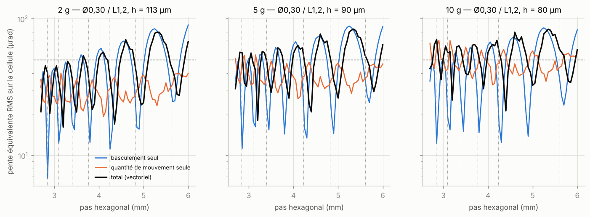

### 6.3 Comparaison (entrefer optimal par masse parmi 80 / 100 / 120 µm, cellule 8 × 8)

Temps d'usinage indicatif : ≈ 9 s/trou (positionnement 0,5 s, perçage borgne Ø2 × 24–34 mm
au foret carbure avec débourrage ≈ 5 s, orifice Ø0,3 × 1,2 mm au micro-foret ≈ 3,5 s), hors
changements d'outil et contrôle ; le lot structure estime 21 h pour 6 000 trous et 50 h pour
17 000 (`calc/structure/results/recommended_params.toml`).

| Configuration | trous | usinage (h) | Q max (m³/h) | J RMS (µrad) |
|---|---|---|---|---|
| **hex 5,00 Ø0,30 L1,2 (retenu)** | 6 017 | 15 (21 lot structure) | 19,6 | **32,7** |
| hex 2,94 Ø0,30 L1,2 (candidat 10/2026, perçage borgne Ø1,5) | 17 273 | 43 (50) | 45,5 | 34,9 |
| hex 4,23 Ø0,30 L1,0 / L1,2 (magique) | 8 465 | 21 | 26 | 59,9 / 56,5 |
| hex 4,23 Ø0,35 / Ø0,40 (L1,2) | 8 465 | 21 | 36 / 48 | 90 / 139 |
| hex 4,82 Ø0,30 L1,0 / L1,2 (magique) | 6 481 | 16 | 21 | 64,8 / 61,5 |
| hex 4,82 Ø0,35 / Ø0,40 (L1,2) | 6 481 | 16 | 29 / 41 | 95 / 130 |
| baseline hex 4 / 5 / 6, Ø0,40 L1,0 | 9 321 / 6 017 / 4 175 | 23 / 15 / 10 | 53 / 37 / 30 | 105 / 90 / 99 |
| carrée 4 / 5 / 6, Ø0,40 L1,0 | 8 281 / 5 329 / 3 721 | 21 / 13 / 9 | 51 / 34 / 26 | 138 / 105 / 107 |

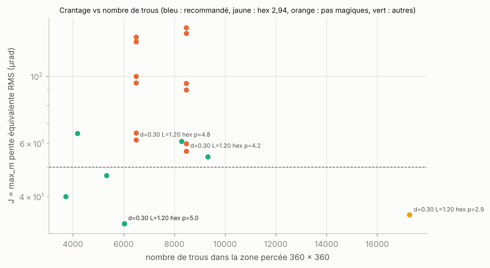

### 6.4 Robustesse aux tolérances réelles (J RMS pire masse, sur la loi h(m))

| Cas | hex 5 Ø0,30 (retenu) | hex 2,94 | hex 4,23 | hex 4,82 | baseline |
|---|---|---|---|---|---|
| nominal | 32,7 | 35,0 | 61,6 | 62,3 | 89,9 |
| Ø palet −0,2 / −0,1 mm | 33,4 / 33,9 | 39,8 / 35,4 | 53,7 / 56,6 | 55,5 / 60,7 | 83,7 / 84,4 |
| Ø palet +0,1 / +0,2 mm | 34,8 / 36,3 | 32,1 / 30,8 | 67,2 / 62,6 | 67,2 / 63,5 | 94,5 / 102,7 |
| arrondi d'arête r = 0,2 / 0,5 mm | 34,0 / 39,7 | 35,2 / 47,4 | 59,0 / 50,7 | 61,9 / 46,7 | 85,2 / 76,1 |
| bord abrupt (modèle) | 40,9 | 63,0 | 65,4 | 58,7 | 82,4 |
| δ_min ×0,5 / ×2 (quantité de mouvement) | 62,4 / 26,8 | 57,3 / 29,8 | 78,4 / 53,4 | 78,5 / 54,9 | 169 / 49 |
| crête sur la cellule (nominal) | 57 | 61 | 136 | 105 | 185 |

L'arrondi d'arête de rayon r est modélisé par un rayon porteur effectif R − ΔR,
ΔR = r − √(2 r h − h²) (le film « s'arrête » où le jeu supplémentaire atteint h) **[P]**.

- **Configuration retenue** : peu sensible au diamètre du palet (±0,2 mm → +2 à +11 %) et à
  un arrondi ≤ 0,2 mm ; un arrondi de 0,5 mm ou une arête vive parfaite dégradent de 20–25 %.
  **Spécification palet : arête inférieure cassée r = 0,1–0,2 mm, Ø30 ± 0,1.**
- La principale incertitude est **le modèle de quantité de mouvement** (δ_min) : 27–62 µrad.
  Une plaque d'essai (coupon 100 × 100 mm percé au pas 5) est indispensable pour mesurer
  le crantage réel (dérive d'un palet libre, ou effort tenu par le robot) avant usinage final.
- **Pas magiques** : la composante de basculement y est faible au nominal (10 g, pas 4,23 :
  24 µrad) mais le minimum est **étroit** : elle passe à 13 µrad (Ø −0,2) et 36 µrad (Ø +0,2),
  soit ±50 % pour ±0,2 mm de diamètre de palet ; la valeur dégradée du total est 54–67 µrad
  (4,23) et 56–67 µrad (4,82). Le pas magique n'est donc pas un levier utile ici : la poussée
  de quantité de mouvement (≈ 45 µrad à 10 g) domine et ne dépend pas du pas.

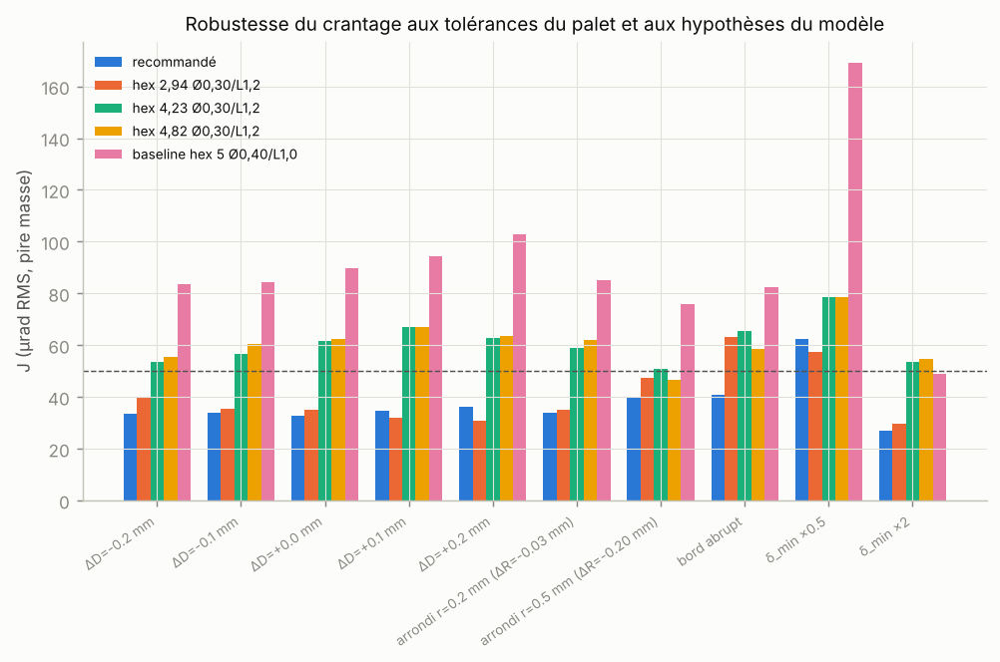

## 7. Dispersion de fabrication des orifices (`montecarlo.py`)

Chaque trou : d_i = d0 + N(0, tol/3), L_i = L0 + N(0, 0,05/3) mm ; débit mis à l'échelle
s_i = (d_i/d0)^a (L_i/L0)^b (a = 2,7–3,0 ; b = −0,34…−0,49) ; 300 tirages par cas, position
aléatoire dans la cellule ; on retranche la solution nominale (part aléatoire seule).

| Tolérance ± (3σ) sur Ø0,30 | 2 g RMS / 95 % | 5 g RMS / 95 % | 10 g RMS / 95 % | Δh RMS |
|---|---|---|---|---|
| 0,005 mm | 8,5 / 15 | 6,6 / 11 | 5,2 / 9 | 0,1 µm |
| 0,010 mm | 15,7 / 27 | 11,4 / 19 | 9,9 / 17 | 0,2 µm |
| 0,015 mm | 23,8 / 41 | 17,5 / 30 | 14,6 / 26 | 0,3 µm |
| 0,020 mm | 31,1 / 52 | 22,7 / 39 | 18,4 / 32 | 0,5 µm |

- **Tolérance recommandée : Ø0,30 ± 0,005 mm** (allocation ≈ 10 µrad RMS). Micro-forets
  carbure neufs, contrôle par échantillonnage au calibre/débit ; à ±0,010 mm la part aléatoire
  monte à 16 µrad RMS (2 g).
- Décalage systématique du lot (foret à +0,01 mm) : h +3 à +4 µm, absorbé par l'étalonnage
  de la table ps(m).
- **Trou bouché sous un palet** : 136–159 µrad (pente crête), Δh −2 µm ⇒ filtration ePM1
  obligatoire et contrôle de propreté. **Bavure obstruant 25 % de l'entrée** : 20–29 µrad ⇒
  ébavurage côté perçage borgne impératif (§ 12).

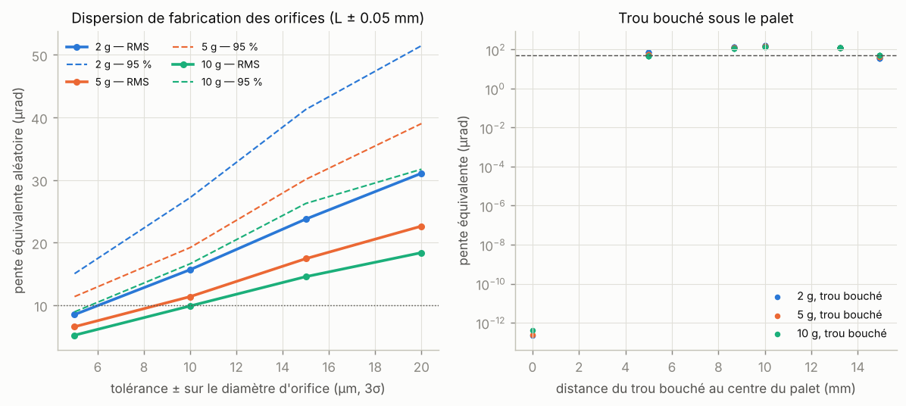

## 8. Dynamique du palet (`dynamics.py`) [V]

Reynolds instationnaire isotherme compressible linéarisée, valeurs propres du système
film + palet, entrefer selon la loi h(m) :

| Masse | h (µm) | ps (Pa) | k_z (N/m) | mode vertical | basculement | V critique / V perçage | dh/dps (µm/Pa) | τ visqueux (s) |
|---|---|---|---|---|---|---|---|---|
| 2 g | 113 | 66 | 206 | sur-amorti (ζ = 1) | 37 Hz, ζ 0,56 | 95 | 1,32 | 17,7 |
| 5 g | 90 | 139 | 461 | 32 Hz, ζ 0,75 | 43 Hz, ζ 0,38 | 41 | 0,71 | 35 |
| 10 g | 80 | 266 | 916 | 42 Hz, ζ 0,50 | 46 Hz, ζ 0,25 | 20 | 0,37 | 62 |

- Stable pour toutes les masses ; le marteau pneumatique n'apparaîtrait qu'avec un volume
  aval par trou ≥ 20× (10 g) à 95× (2 g) celui du perçage borgne : **restriction en haut
  confirmée**, aucun volume ne doit être ajouté entre l'orifice et le film (pas de lamage
  en face supérieure, chanfrein ≤ 0,05 mm).
- ±0,3 Pa de régulation ⇒ ±0,4 µm (2 g) à ±0,1 µm (10 g) d'entrefer.
- Amortissement visqueux de Couette : τ = m h/(μ A) = 18–62 s (translation et rotation).

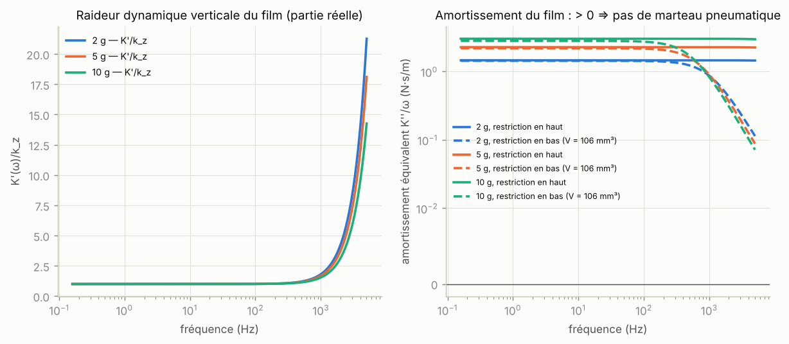
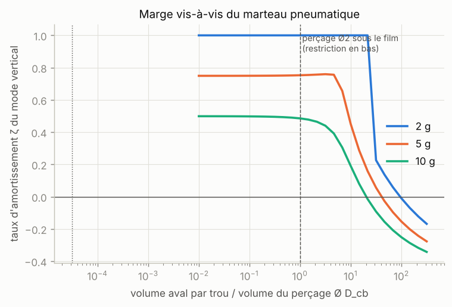

## 9. Réseau, chaîne aéraulique et ventilateur (`setpoints.py`, `network.py`)

### 9.1 Table de consigne et enveloppe

ps(m) = modèle discret moyenné sur la cellule au h(m) de la loi ; bande d'incertitude du
modèle (lois d'orifice shah_sharp / coord, K_c = 0 / 1) : ±2–3 % sur ps (±2 µm sur h).

| m (g) | 2 | 3 | 4 | 5 | 6 | 7 | 8 | 9 | 10 |
|---|---|---|---|---|---|---|---|---|---|
| h (µm) | 113 | 103 | 96 | 90 | 86 | 82 | 80 | 80 | 80 |
| ps (Pa) | 65,5 | 91,2 | 115,5 | 138,9 | 161,7 | 184,0 | 208,4 | 236,6 | 265,1 |
| Q total (m³/h) | 7,2 | 9,1 | 10,8 | 12,2 | 13,5 | 14,7 | 16,0 | 17,4 | 18,7 |
| Δp ventilateur filtre neuf (Pa) | 70 | 97 | 124 | 149 | 174 | 198 | 225 | 255 | 287 |

Enveloppe (`setpoints.json`, clé `envelope`) : **ps 57–297 Pa** (0,9 × bande basse à 2 g ;
1,1 × bande haute à 10 g) ; Q 6,5–20,0 m³/h ; Δp ventilateur 60–327 Pa (60 Pa filtre neuf au point bas, 327 Pa filtre colmaté au point haut).
Avec les marges de `network.py` (×1,15 sur Q et Δp) : **point max 23,1 m³/h sous 375 Pa,
point min 5,7 m³/h sous 53 Pa** ; exposant de la courbe réseau 1,4–1,6 (non quadratique).

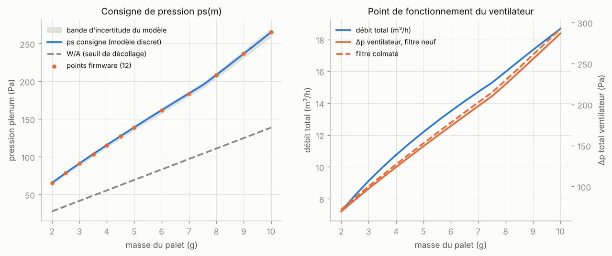

### 9.2 Chaîne retenue (pertes au point max)

Filtre ePM1 287 × 287 en caisson 320 × 320 × 220 → **buse débitmétrique col Ø30** (Δp col
4–39 Pa, Re 5 000–16 000) → ventilateur → adaptateur → Ø50 → diffuseur conique 2θ = 7°
Ø50 → Ø80 (L ≈ 245 mm) → manchon souple L100 → conduit Ø80 + coude → entrée centrale par le
fond, disque déflecteur Ø200 à 25 mm → chambre de distribution 62 mm → tôle inox ép. 1,
trous Ø2 pas 8 quinconce (β = 5,7 %) + nappe média 10 mm → tranquillisation 80 mm → plaque.
Rapport Δp tôle / pression dynamique amont ≈ 170 ; non-uniformité estimée ≤ 0,0015 %
(≪ ±1 %) ; constante de temps pneumatique du plenum 9–18 ms.

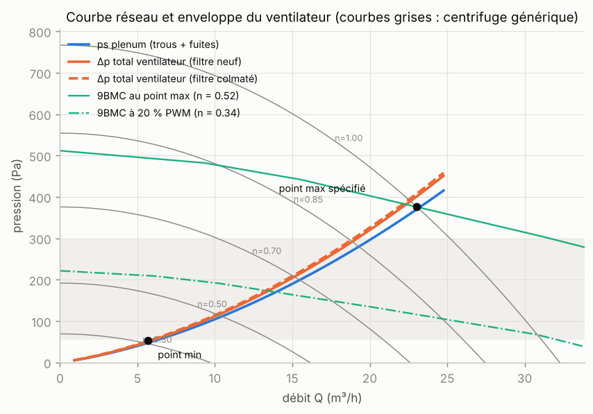
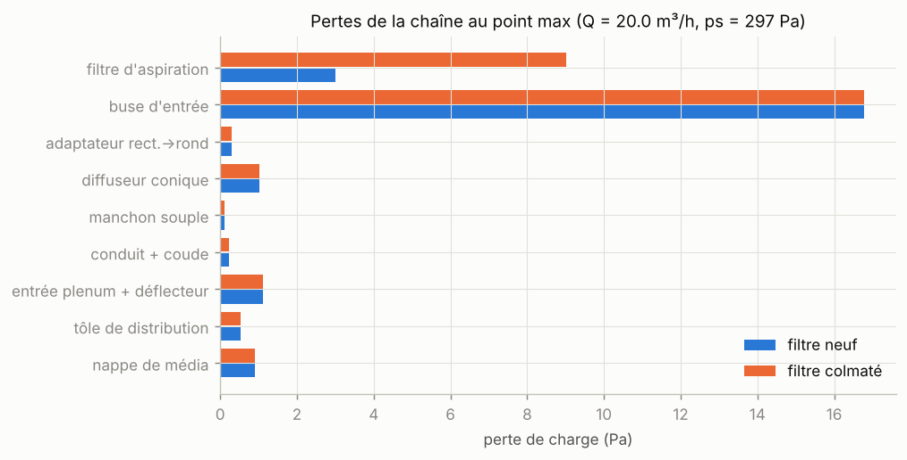
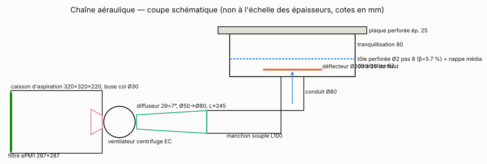

### 9.3 Validation du San Ace 9BMC24P2G001

Courbe à 100 % lue dans `docs/research/ventilateurs.md`, transposée par similitude
(Q ∝ n, Δp ∝ n²) ; contrôle sur la courbe à 60 % : écart 0 à −7 % jusqu'à 30 m³/h.

- **Point max** (23,1 m³/h, 375 Pa) : n = 0,52 (≈ 4 250 min⁻¹, ≈ 42 % PWM estimé) ; marge de
  pression à pleine vitesse ×4,6. **Validé.**
- **Point min** (5,7 m³/h, 53 Pa) : n = 0,18 (≈ 1 480 min⁻¹), sous la vitesse documentée à
  20 % PWM (2 800 min⁻¹, n = 0,34) et au niveau du coude non documenté (≈ 1 500 min⁻¹) ⇒
  **non atteignable par la vitesse seule**.
- **Vanne de décharge** en aval du diffuseur, rejet canalisé loin de la table :
  - fixe : impossible (dimensionnée pour le point bas, Ø ≈ 39 mm, elle ferait dépasser 100 %
    de vitesse au point haut) ;
  - **à deux états** (électrovanne ou registre motorisé, section ≈ 1 170 mm², Ø ≈ 39 mm) :
    vanne ouverte, ps couvre 57–270 Pa ; vanne fermée, 209–297 Pa (n ≥ 1,15 × n(20 %)).
    **Commutation à ≈ 238 Pa** (≈ 8,1 g), hystérésis ±15 Pa. Débit ventilateur au point bas
    32 m³/h dont 25 m³/h déchargés.
  - un étranglement série fixe est écarté : ≈ 217 Pa à dissiper au point bas, inacceptable au
    point haut (perte ∝ Q²).

### 9.4 Alternative

**San Ace 9BMB24P2G01** (755 Pa à débit nul, 80 m³/h libre, PWM 25 kHz) : n = 0,77 au point
max, 0,28 au point min (rapport 2,8). Mieux adapté (moins de bruit et de chaleur), mais sa
vitesse à 20 % PWM n'est pas documentée : si elle vaut ≈ 0,34 comme le 9BMC, la décharge
reste nécessaire pour les palets ≤ 3 g. À mesurer sur banc avant de choisir.

## 10. Jets libres, courants d'air et thermique

### 10.1 Jets (`jets.py`) [P]

Jets laminaires (Re 84–258 sur l'enveloppe, Re_crit d'un jet rond ≫ ces valeurs sur
quelques dizaines de diamètres) : demi-largeur r½ = 5,94 x/Re (Schlichting) ; coalescence
(r½ = p/2) à 3,6–11 cm de la plaque (borne turbulente 0,094 x : 2,7 cm). Au-dessus, panache
fusionné ascendant : vitesse moyenne Q/A = 0,014–0,042 m/s, vitesse « quantité de
mouvement » V√φ = 0,24–0,74 m/s (φ = 0,33 % de taux d'ouverture).

**Courants d'air** : traînée ½ρ C_d(Re) D H v² sur la face latérale (C_d = 1 + 10 Re^−2/3).
Pente équivalente à 0,05 m/s : 34 µrad (2 g), 13 (5 g), 7 (10 g) ; **vitesse admissible pour
5 µrad : 17 mm/s (2 g)**. Les courants d'un local (0,05–0,2 m/s) imposent un **écran** :
parois PMMA/verre 120 mm de haut (≥ hauteur de coalescence des jets, 36–110 mm), sans fente basse, couvercle respirant (nid d'abeille
alu cellule 3–6 mm × 20 mm ou toile filtrante) pour laisser sortir le panache.
Écoulement d'entraînement en bord de zone percée (α ≈ 0,05) : 13–34 mm/s ⇒ ≈ 3–4 µrad pour un
palet proche du bord de la zone de travail (nul au centre par symétrie) **[P]**.

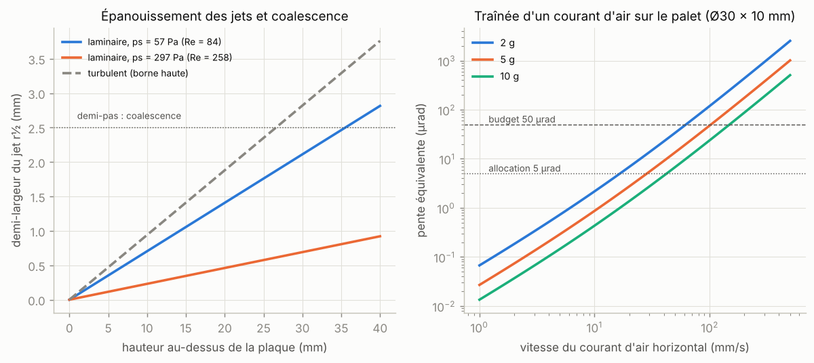

### 10.2 Thermique (`thermal.py`) [P]

- Échauffement de l'air par le ventilateur (toute la puissance électrique dans la veine,
  η = 0,25, plancher 4,6 W à 20 % PWM) : ΔT = P/(ρ c_p Q) = 1,9 K (2 g), 1,1 K (5 g),
  1,0 K (10 g) en modulation de vitesse ; ≈ 1,5 K à vitesse constante avec décharge.
- Établissement thermique dans les perçages Ø2 (Re 14–37) : L_th = 0,05 Re Pr D = 1–2,6 mm
  ⇒ l'air sort à la température de la plaque ; l'échange se fait dans les premiers mm.
- Modèle 1D transitoire (méthode des lignes) : gradient dessous − dessus **1,5–2,7 mK** en
  régime établi, **≤ 5,2 mK** au démarrage à froid ou après un échelon 2 g → 10 g (limite
  50 mK) ⇒ ≤ 0,8 µrad de pente. Constante de temps de mise en température : ≈ 14 min.
- Recommandations : rampes de consigne lentes (≥ 1 min) et préchauffage 1 h ; la stratégie
  « vitesse constante + décharge proportionnelle » supprime les transitoires de ΔT
  (option si la stabilité thermique des inclinomètres l'exige).

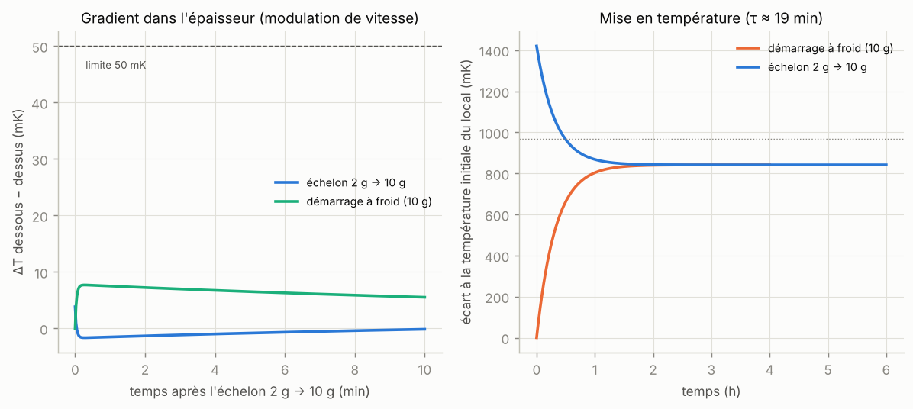

## 11. Fonctionnement passif sans compensation : les forces parasites comme erreur de mesure

> Décisions de l'utilisateur (2026-11-03/04) : les palets portent des **actionneurs
> électrostatiques radiaux** et la table sert à **caractériser** le mouvement qu'ils
> produisent. Les palets ne sont pas pilotés en position et **aucune compensation en ligne**
> n'est admise. Toute force dans le plan qui dépend de la position ou du temps est donc une
> **erreur de mesure** : il faut la minimiser et la chiffrer. La piste « piégeage volontaire »
> (puits de crantage plus profonds) est **abandonnée**.
> Scripts : `calc/aero/drift_sim.py` (≈ 10 s), `calc/aero/parasitic.py` (≈ 8 s),
> bibliothèque `calc/aero/trap.py`.

### 11.1 Nature du champ de crantage (`drift_sim.py`, `trap.py`) [P]

Le champ s(x) est calculé sur une grille 24 × 24 de la cellule, périodisé par série de
Fourier, puis interpolé. Il est **conservatif à 95–97 %** (décomposition de Helmholtz) et sa
**moyenne est nulle** : il dérive d'un potentiel périodique. Il n'y a donc pas de
circulation qui entraînerait une dérive systématique. Ses puits sont peu profonds :

| Masse | crantage RMS / crête (µrad) | barrière (µJ/kg) | vitesse de capture | oscillation (période ; Q = ωτ) | τ = m h/(μA) | maintien statique (pire / meilleure direction) |
|---|---|---|---|---|---|---|
| 2 g | 24,5 / 50,5 | 0,50 | 1,0 mm/s | 6,7 s ; 16 | 18 s | 43 / 51 µrad (0,85 µN) |
| 5 g | 26,2 / 57,4 | 0,37 | 0,86 mm/s | 6,6 s ; 34 | 35 s | 30 / 50 µrad (1,5 µN) |
| 10 g | 32,1 / 67,3 | 0,30 | 0,77 mm/s | 6,5 s ; 60 | 63 s | 34 / 56 µrad (3,3 µN) |

- Un palet **posé sans vitesse** au fond d'un puits y reste tant que la pente lente reste
  sous 30–43 µrad. Il oscille alors autour du fond, avec un amortissement très faible
  (temps 2τ = 35–125 s).
- Un palet **en mouvement**, actionneurs coupés à v0 ≥ 1 mm/s, n'est re-capturé que si la
  pente résiduelle est ≤ 0–5 µrad. Au-delà, il glisse indéfiniment à v ≈ g θ τ, soit
  0,17 / 0,35 / 0,61 mm/s par µrad (2 / 5 / 10 g). L'amortissement de Couette est le seul
  frein : il est très faible (Q = 16–60).
- Une force aléatoire de 0,1 µN (courant d'air de 17 mm/s sous l'écran) ne fait pas sortir
  un palet de son puits. Le palet erre de 0,06 à 0,15 mm.
- La version du 2026-11-03 donnait un « seuil » de 5–15 µrad. Il venait de palets lâchés en
  position quelconque, donc chargés d'énergie potentielle. Ce chiffre correspond au seuil de
  **re-capture**, pas au seuil de maintien.

**Pour une table de caractérisation, ces puits sont une erreur et non une aide** : ils
retiennent un palet faiblement actionné et l'empêchent de démarrer. La force à vaincre est
de 0,9 / 1,5 / 3,3 µN (2 / 5 / 10 g, pire direction). Ils modulent ensuite le mouvement à
la fréquence v/p.

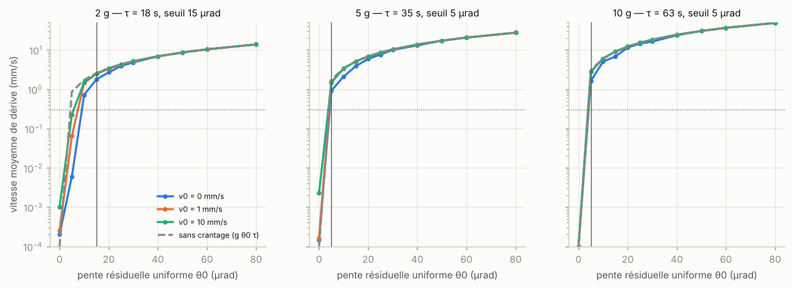
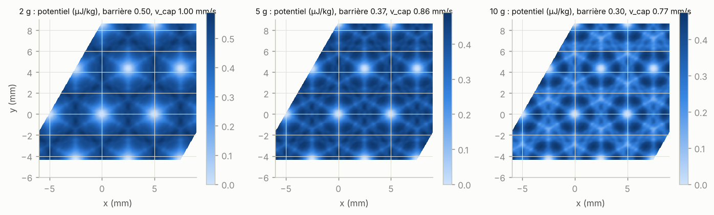

### 11.2 Bilan des forces parasites (`parasitic.py`)

Les forces sont exprimées en pente équivalente, en µN et en accélération parasite
(g × pente ; 10 µrad = 0,098 mm/s², quelle que soit la masse).

| Terme (RMS / crête) | 2 g (µN) | 5 g (µN) | 10 g (µN) | nature |
|---|---|---|---|---|
| crantage (basculement + quantité de mouvement) | 0,48 / 0,99 | 1,29 / 2,81 | 3,15 / 6,6 | déterministe, périodique (p = 5 mm), moyenne nulle |
| jets de bord (ordre de grandeur) | 0,18 / 0,44 | 0,50 / 1,26 | 1,18 / 2,9 | déterministe, périodique |
| dispersion des orifices ±0,005 mm | 0,17 / 0,30 | 0,32 / 0,56 | 0,51 / 0,88 | statique, aléatoire de trou à trou |
| pente résiduelle de plaque (budget structure 30 µrad) | 0,42 / 0,59 | 1,04 / 1,47 | 2,1 / 2,9 | statique, basse fréquence spatiale |
| courants d'air résiduels sous écran | 0,10 / 0,20 | 0,10 / 0,20 | 0,10 / 0,20 | aléatoire, instationnaire |
| balourd du palet (5 µm) | 0,09 | 0,22 | 0,42 | déterministe, tourne avec le palet |
| **total RSS (RMS)** | **0,69 µN** | **1,78 µN** | **4,0 µN** | — |
| accélération parasite RMS | 0,35 mm/s² | 0,36 mm/s² | 0,40 mm/s² | — |

**Rapport signal / parasite** = F_act / F_par. Sans correction, il faut F_act ≥ 7 / 18 /
40 µN pour un rapport de 10 (2 / 5 / 10 g) et ≥ 70 / 180 / 400 µN pour un rapport de 100.
Le crantage et la pente de plaque dominent, à parts comparables.

### 11.3 Erreur de trajectoire sur une fenêtre de mesure

Le calcul suit 48 palets partant du repos en position et en direction aléatoires, sous
F_act constante. On les compare à la trajectoire idéale (Couette seul). Le tableau donne
l'erreur RMS en mm et, entre parenthèses, le déplacement idéal. « — » signale qu'un palet
sortirait de la zone de 300 mm.

| 10 g | T = 1 s | T = 5 s | T = 10 s | T = 30 s |
|---|---|---|---|---|
| F = 1 µN, crantage seul | 0,15 (0,0) | 1,6 (1,2) | 4,0 (4,7) | 25 (39) |
| F = 1 µN, crantage + pente 30 µrad | 0,22 | 3,5 | 12,4 | 102 |
| F = 10 µN, crantage seul | 0,15 (0,5) | 1,6 (12) | 3,8 (48) | — |
| F = 100 µN, crantage seul | 0,08 (5) | 0,5 (122) | — | — |
| F = 1 mN, crantage seul | 0,06 (50) | — | — | — |
| pente 30 µrad seule (toute F) | 0,15 | 3,6 | 14,0 | 114 |

(2 g et 5 g : même ordre de grandeur, voir `parasitic.json` et la figure.)

- Le **crantage** donne une erreur **bornée**, de 1 à 4 mm, quand le palet est lent :
  oscillation dans les puits. Elle tombe sous 0,1–0,5 mm dès que le palet traverse vite
  les cellules (F ≥ 100 µN), car le champ de moyenne nulle se moyenne alors.
- La **pente** donne une erreur qui croît comme ½ g θ T² (T ≪ τ) : 14 mm en 10 s pour
  30 µrad. Pour les fenêtres longues, elle domine.

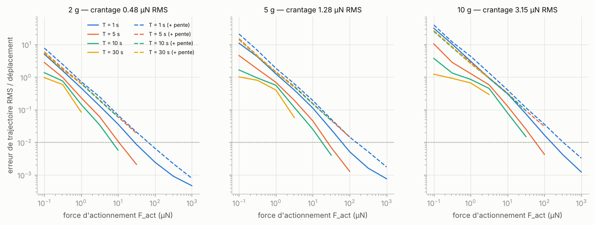
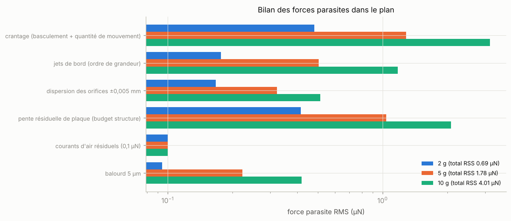

### 11.4 Correction a posteriori par une carte de forces étalonnée (post-traitement)

Une correction a posteriori est envisageable, sans aucun pilotage : on retranche des
trajectoires mesurées une carte de forces F_par(x, m) étalonnée.

- **Pente de plaque** : statique et lisse. Elle s'étalonne par la dérive de palets non
  actionnés (moyennée sur plusieurs cellules) et par les ADXL355. Incertitude ≈ 2–3 µrad.
- **Crantage et jets de bord** : périodiques, de moyenne nulle et identiques sur toute la
  zone. On les représente par une série de Fourier (2–3 anneaux) par masse, étalonnée sur
  quelques cellules (oscillations libres dans les puits, ou palets à faible F_act connue).
  La limite est le **recalage du réseau de trous** dans le repère de mesure. Le crantage
  résiduel vaut 6 / 8 / 10 µrad pour un recalage δ = 0,05 mm, 12 / 15 / 18 µrad pour
  0,1 mm et 17 / 22 / 28 µrad pour 0,2 mm (2 / 5 / 10 g). Une erreur d'amplitude de ±10 %
  y ajoute 1 µrad.
- **Balourd** : 2 paramètres par palet, dans son repère.
- **Non cartographiables** : la dispersion des orifices (5–8,5 µrad) et les courants d'air.
- Bilan avec δ = 0,1 mm : 35 → 17 µrad (2 g), 36 → 18 (5 g), 41 → 21 µrad (10 g), soit un
  **gain d'environ 2**. Avec δ = 0,05 mm (mires gravées dans la plaque, repérées par la
  caméra), le résultat est d'environ 12–14 µrad. L'incertitude du modèle de quantité de
  mouvement (facteur 2) est absorbée par l'étalonnage.

### 11.5 Réduction à la source (leviers évalués à 10 g, h = 80 µm)

| Variante | crantage RMS / crête (µrad) | ps (Pa) | commentaire |
|---|---|---|---|
| retenu : hex 5, Ø0,30, L1,2 | 33 / 57 | 266 | — |
| h = 70 µm | 30 / 54 | 243 | gain de 8 % ; demande h_min = 70 µm au cahier des charges |
| **Ø0,25, L1,0, hex 5** | **22 / 38** | 310 | **−34 %** ; 2 g : 22 / 38 ; 5 g : 21 / 36 ; débit max ≈ 15 m³/h |
| Ø0,25, L1,0, hex 4 | 40 / 75 | 251 | plus mauvais |
| hex 2,94, Ø0,30 | 33 / 72 | 192 | sans gain |
| hex 3,5, Ø0,30 | 38 / 83 | 208 | sans gain |

Le pas, la maille et l'entrefer sont déjà optimisés (§ 5). **Le seul levier significatif
est un orifice plus fin**, contre la limite d'usinabilité d ≥ 0,30 mm retenue jusqu'ici.
Avec Ø0,25 ± 0,005 mm, la part aléatoire de la dispersion passe d'environ 8,5 à environ
10 µrad RMS (estimation par mise à l'échelle). L'orifice est aussi plus sensible au
colmatage. La plaque, la pente, le balourd et l'écran restent les autres postes.

### 11.6 Recommandation

1. **Garder la maille hex 5 mm** (configuration fusionnée dans `design.toml`).
2. **Percer sur la plaque d'essai deux zones, Ø0,30 / L1,2 et Ø0,25 / L1,0**, puis mesurer
   le crantage réel en dérive libre et en oscillation dans les puits. Adopter Ø0,25 si
   l'usineur tient ±0,005 mm : −34 % de crantage, et crête < 50 µrad pour toutes les masses.
3. Exiger de la structure une pente résiduelle de plaque ≤ 10 µrad après réglage et
   cartographier la pente. Pour les fenêtres de mesure ≥ 5 s, la pente domine l'erreur
   de trajectoire.
4. Prévoir dès la CAO des **mires de recalage du réseau** (repérage du réseau à ±0,05 mm).
   Elles rendent la correction a posteriori efficace (gain ≈ 2–3).
5. Choisir F_act et la fenêtre de mesure à l'aide du § 11.3. Sans correction, l'erreur
   relative de trajectoire reste sous 1 % pour F_act ≳ 100 µN avec T ≤ 1–5 s. Pour
   F_act ≲ 10 µN, la correction a posteriori et des fenêtres courtes sont indispensables.

## 12. Recommandations de fabrication et d'essai

1. **Perçage** : orifice Ø0,30 ± 0,005 percé depuis la face supérieure (avant finition de
   la face), perçage borgne Ø2 depuis le dessous ; fond conique 118° uniforme (l'entrée
   conique augmente q de 6 % : c'est l'uniformité qui compte). **Ébavurage de l'entrée de
   l'orifice côté perçage borgne** (bavure de sortie du micro-foret) : ébavurage thermique
   ou par écoulement abrasif, puis contrôle au débit d'un échantillon (≥ 2 % des trous,
   critère ±3 % sur q à 100 Pa).
2. Finition de la face supérieure **après** perçage : vérifier qu'elle ne referme ni ne
   chanfreine les orifices au-delà de 0,05 mm (contrôle optique).
3. **Plaque d'essai** 100 × 100 au pas 5 / Ø0,30 avant l'usinage de la plaque finale :
   mesure de q(Δp) (Cd réel), de la table ps(m) et du crantage (dérive de palets, ou
   effort tenu par un robot) pour recaler le modèle de quantité de mouvement.
4. Palets : Ø30 ± 0,1 mm, arête inférieure cassée r = 0,1–0,2 mm, centre de gravité centré à
   ≤ 5–10 µm ou balourd étalonné.
5. Filtration ePM1 ≥ 55 % à l'aspiration, montage propre (soufflage + ultrasons de la plaque).
6. Écran 120 mm avec couvercle respirant ; rejet de la vanne de décharge canalisé hors de la
   zone d'essai.

## 13. Données pour la CAO

| Élément | Valeur |
|---|---|
| Zone percée | carré 360 × 360 centré ; maille **hexagonale pas 5,000 mm**, rangées parallèles à X ; ≈ 6 000 trous (5 935–6 017 selon l'origine du réseau) |
| Orifice | **Ø0,30 ± 0,005**, longueur (voile) **1,20 ± 0,05**, débouchant en face supérieure, arête de sortie vive ou chanfrein ≤ 0,05 × 45° |
| Perçage borgne d'alimentation | **Ø2,0**, depuis la face inférieure, profondeur e − 1,20 (e = 25 → 23,8 ; e = 35 → 33,8), fond conique 118° |
| Position | tolérance de position des orifices ±0,05 mm (sans effet mesurable sur le crantage) ; pas cumulé ±0,1 mm sur 360 |
| Plenum | intérieur 440 × 440 (ou 430, lot structure), hauteur 150 : distribution 62 + tôle + tranquillisation 80 |
| Tôle de distribution | inox ép. 1, trous Ø2 pas 8 quinconce (β = 5,7 %), + nappe média polyester 10 mm |
| Entrée d'air | conduit Ø80 central par le fond, disque déflecteur Ø200 à 25 mm du fond |
| Diffuseur | conique 2θ = 7°, Ø50 → Ø80, L ≈ 245 mm ; manchon souple L100 ; coude grand rayon |
| Ventilateur | San Ace 9BMC24P2G001 (97 × 95 × 33), sur plots, adaptateur sortie → Ø50 |
| Vanne de décharge | Ø ≈ 40 mm (section 1 170 mm²), deux états, sur le conduit Ø80 après le diffuseur, rejet canalisé |
| Aspiration | caisson 320 × 320 × 220, filtre ePM1 287 × 287 × 48, **buse col Ø30** profil ISO 5801 |
| Prises de pression | plenum : 4 piquages Ø4 en chambre de tranquillisation (milieu des parois) + 1 centre ; buse : col et caisson |
| Écran | parois 120 mm PMMA/verre 4–6 mm au bord de la zone percée, couvercle nid d'abeille alu cellule 3–6 × 20 mm |
| Mires de recalage du réseau | ≥ 3 mires gravées en face supérieure, hors zone de travail, cotées par rapport au réseau de trous à ±0,02 mm : recalage caméra ±0,05 mm pour la correction a posteriori (§ 11.4) |
| Plaque d'essai | 100 × 100, hex 5, deux zones Ø0,30/L1,2 et Ø0,25/L1,0 (choix de l'orifice, § 11.6) |

## 14. Données pour le firmware

- **Table masse → pression** : `calc/aero/results/setpoints.json`, clé `points` (12 points,
  format existant {mass_g, p_Pa}, champ supplémentaire `h_um` ignoré par le parseur) ; erreur
  d'interpolation linéaire ≤ 1,25 Pa (≤ 0,7 µm d'entrefer). `h_target_um` = 90,3 µm (5 g,
  indicatif). Ajustement global ps = c2 m² + c1 m + c0 (clé `fit_quadratic`, erreur ≤ 3,3 Pa).
  Loi d'entrefer : clé `h_law`. **À recaler sur banc** (span du SDP810, Cd réel des trous).
- **Enveloppe** : clé `envelope` : ps 57–297 Pa ; garde de sécurité 400 Pa.
- **Régulation** : ±0,3 Pa ⇒ ±0,1–0,4 µm ; plenum τ = 9–18 ms ; dh/dps = 1,32 / 0,71 /
  0,37 µm/Pa (2 / 5 / 10 g) ; modes du palet 32–46 Hz (ne pas exciter : bande de la boucle
  ≤ 5 Hz, rampes ≥ 1 s pour les palets, ≥ 1 min pour la thermique).
- **Ventilateur** (9BMC, PWM 25 kHz) : rapport cyclique ≈ 42 % au point max (estimation) ;
  plancher 20 % (2 800 min⁻¹) ; ne pas réguler sous ≈ 23 % (n = 1,15 × n(20 %)).
- **Vanne de décharge** : ouverte pour ps < 223 Pa, fermée pour ps > 253 Pa (hystérésis
  autour de 238 Pa) ; commutation à débit de palet nul de préférence (saut de vitesse).
- **Débit** (buse col Ø30, α = 0,98) : Q = α·π·0,03²/4·√(2 Δp_col/ρ) ; 4–39 Pa sur la plage.
- **Pas de compensation en ligne** (décision utilisateur). Le logiciel hôte peut corriger
  a posteriori les trajectoires (§ 11.4) avec la carte de crantage périodique
  (`cogging.json`, `drift_sim.json`), le balourd par palet, la traînée de Couette
  c = μ·A/h(m) (τ = 18–63 s) et la carte de pente.

## 15. Limites et risques ouverts

1. **Modèle de quantité de mouvement du film** (régularisation δ_min) : facteur ≈ 2 sur le
   terme dominant à 10 g ⇒ crantage 27–62 µrad RMS. Seule une mesure tranche (§ 12.3).
2. **Pas de compensation en ligne** (table de caractérisation) : les forces parasites
   (0,7 / 1,8 / 4,0 µN RMS pour 2 / 5 / 10 g) bornent la plus petite F_act mesurable
   (§ 11.2–11.3). La correction a posteriori dépend du recalage du réseau (±0,05–0,1 mm).
   Le levier Ø0,25 reste à valider à l'usinage.
3. Tolérance Ø0,30 ± 0,005 mm et ébavurage de l'entrée côté perçage borgne : exigeants ;
   à valider avec l'usineur sur la plaque d'essai.
4. Vitesse minimale réelle du 9BMC (et du 9BMB) sous 20 % PWM non documentée ; la vanne de
   décharge ajoute un actionneur et un rejet d'air à canaliser.
5. Entraînement et recirculation sous l'écran estimés en ordre de grandeur seulement
   (visualisation par fumée recommandée).
6. Entrefer en butée à 80 µm pour ≥ 7,5 g : si le cahier des charges autorisait 70 µm,
   le crantage à 10 g baisserait d'environ 10 % ; à l'inverse, planéité palet + plaque
   (5 + 6 µm) consomme ≈ 14 % de l'entrefer.

## Historique

- 2026-10-29 : première exécution (configuration hex 2,94 / Ø0,30 / L1,2 à h = 100 µm fixe,
  J = 45 µrad, ≈ 17 300 trous).
- 2026-11-03 : entrefer cible dépendant de la masse intégré à l'optimisation ⇒ hex 5 /
  Ø0,30 / L1,2 (J = 32,7 µrad) retenu selon le critère d'origine ; hex 2,94 équivalent en
  crantage mais dominé en débit et en nombre de trous ; pas magiques en comparaison
  informative ; Monte-Carlo, jets, thermique, validation ventilateur, compensation logicielle.
- 2026-11-04 : compensation exclue (table de caractérisation, actionneurs électrostatiques).
  § 11 réécrit : champ de crantage conservatif, puits, erreur de mesure (µN, mm/s²,
  erreur de trajectoire vs F_act et T), correction a posteriori, levier Ø0,25 (−34 %).
  Nouveaux scripts `trap.py`, `drift_sim.py` (accéléré, ≈ 10 s) et `parasitic.py`,
  intégrés à `run_all` (248 s).
