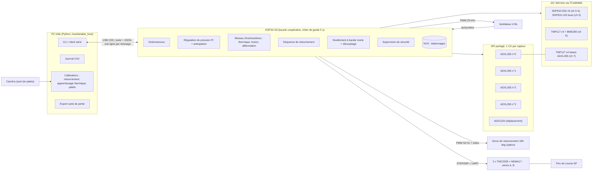
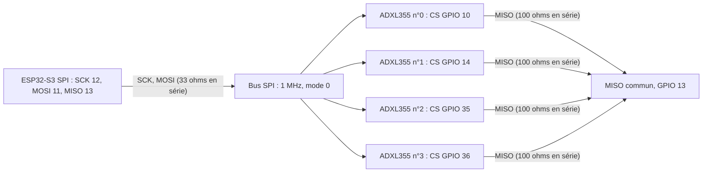
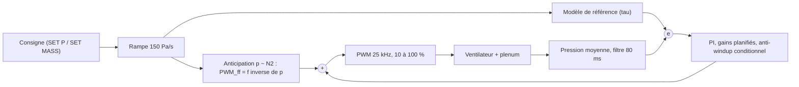
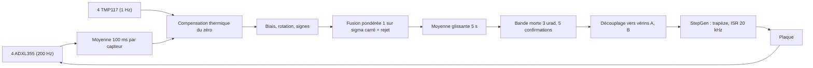
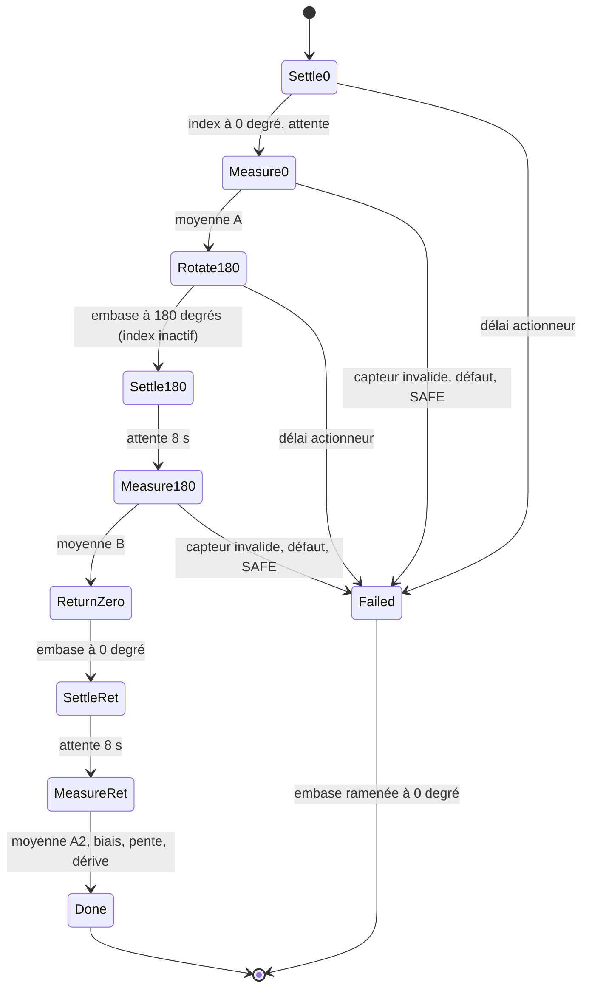

# 07 — Contrôle-commande : électronique, firmware, protocole, procédures

Ce document décrit le contrôleur de la table à coussin d'air : architecture, câblage, boucles de régulation,
mesure d'inclinaison par **réseau de 4 accéléromètres ADXL355**, sécurités, protocole série, procédures
d'exploitation et liste de ce qui reste à valider sur matériel. Il décrit le code tel qu'il est dans le dépôt
(`firmware/`, `host/`) ; tout ce qui n'a pas été éprouvé sur banc est marqué **[À VALIDER]**.

Sources de vérité : `params/design.toml` (valeurs de conception, jamais recopiées à la main dans le firmware :
`firmware/tools/gen_design_params.py` génère `firmware/include/design_params.h`), `firmware/include/config.h`
(brochage, constantes), `firmware/lib/atcore/src/atcore/commands.h` (grammaire du protocole),
`docs/research/capteurs.md` (veille capteurs).

## 1. Décision de conception : l'inclinaison est mesurée par 4 accéléromètres

Il n'y a **pas d'inclinomètre métrologique** (Leica Nivel, Wyler) ni de SCL3300 comme référence. L'inclinaison de la
plaque est mesurée par **4 accéléromètres ADXL355** (SPI, une ligne CS par capteur, bus partagé) répartis sur la
plaque, chacun fixé sur une **embase isotherme** avec un **TMP117 accolé**. Conséquences, à garder en tête :

- Un MEMS dérive de 20 à 150 µrad/°C (ADXL355 : ±0,02 mg/°C typ., ±0,15 mg/°C max, soit 20 à 150 µrad/°C ;
  `docs/research/capteurs.md` §c) et son bruit est de 25 µg/√Hz ≈ 25 µrad/√Hz. Il n'est donc **pas une référence
  absolue à 2 µrad** : le firmware le complète par (i) la **compensation thermique du zéro** par capteur,
  (ii) le **retournement à 180°** (manuel, ou motorisé en option) qui élimine le biais, (iii) la **calibration par
  palets** (`drift-fit`) qui fixe le plan moyen réel, la référence finale étant le comportement des palets.
- Le bruit se moyenne : pour un capteur, σ ≈ 25 µrad/√Hz · √(1/(2·T_moy)), soit ≈ 8 µrad sur 5 s (fenêtre de
  nivellement) et ≈ 2,3 µrad sur 60 s ; avec 4 capteurs indépendants la fusion divise encore par 2 (≈ 4 µrad sur 5 s,
  ≈ 1,2 µrad sur 60 s). La résolution de réglage de 2 µrad (`DESIGN_LEVEL_RES_URAD`) est donc atteignable en
  **statique, après moyennage ≥ 1 min** ; la boucle de nivellement à bande morte de 3 µrad, calculée sur 5 s, travaille
  avec un bruit résiduel de ≈ 4 µrad : c'est pourquoi elle exige 5 confirmations consécutives avant tout mouvement.
  **[À VALIDER]** sur banc (densité spectrale réelle, bruit de vibration, corrélation entre capteurs).
- Les 4 capteurs apportent en plus un **indicateur de déformation/gauchissement** : l'écart inter-capteurs et la
  courbure ajustée (§5.4).

Le SCL3300-D01 reste disponible comme **option de compilation** (env PlatformIO `esp32s3_scl3300`, 1 seul capteur,
pas de fusion).

## 2. Architecture



Boucle coopérative non bloquante (aucune attente active dans `loop()`), périodes de `config.h` :

| Tâche | Période | Rôle |
|---|---|---|
| Lecture SDP810 | 10 ms (100 Hz) | pressions plenum + buse |
| Régulation + sécurités | 20 ms (50 Hz) | PI de pression, `Safety::update` |
| Tachymètre | 100 ms | vitesse du ventilateur (fenêtre glissante) |
| Acquisition des accéléromètres | 5 ms (200 Hz) | lecture des 4 capteurs dans le même tour |
| Sortie inclinaison | 100 ms (10 Hz) | moyenne → compensation → fusion |
| Environnement (TMP117, BME280) | 1 s | températures, densité de l'air |
| Nivellement | 1 s | décision de mouvement des vérins |
| Déplacement (ADS1220) | 50 ms | capteurs de déplacement (option) |
| Retournement | chaque tour | machine à états, actionneur |

## 3. Câblage

### 3.1 Brochage ESP32-S3-DevKitC-1 (`firmware/include/config.h`)

GPIO évités : 0, 45, 46 (strapping), 19/20 (USB natif), 26–32 (flash), 43/44 (UART0). **GPIO 3** (strapping JTAG)
n'est utilisé que pour le contact d'index optionnel ; **GPIO 35/36/37** ne sont libres que sur un module **sans PSRAM
octale** (DevKitC-1-N8 ou -N16, **pas** les versions R8/R16V) **[À VALIDER à la commande du module]**.

| Fonction | GPIO | Remarque |
|---|---|---|
| I²C SDA / SCL | 8 / 9 | vers TCA9548A (0x70, A0–A2 à GND), pull-ups 2,2 kΩ vers 3,3 V |
| RESET# TCA9548A | 4 | actif bas, pull-up 10 kΩ |
| SPI MOSI / SCK / MISO | 11 / 12 / 13 | FSPI, bus partagé |
| **CS ADXL355 n°0, n°1, n°2, n°3** | **10, 14, 35, 36** | une ligne par capteur, repos haut |
| CS ADS1220 / DRDY | 16 / 1 | mode SPI 1 ; DRDY actif bas |
| PWM ventilateur 1 / 2 | 5 / 6 | 25 kHz, 11 bits (LEDC canaux 0 / 1) |
| Tachymètre 1 / 2 | 7 / 15 | collecteur ouvert, pull-up 10 kΩ vers **3,3 V** (jamais 12 V), 2 imp/tr |
| STEP vérins A / B | 39 / 41 | ISR de timer 20 kHz (`StepGen`) |
| DIR vérins A / B | 40 / 42 | |
| EN# commun des TMC2209 | 21 | actif bas |
| UART TMC2209 (TX / RX) | 17 / 18 | TX via 1 kΩ vers PDN_UART, RX direct ; adresses 0 et 1 (MS1/MS2) |
| Fins de course A / B | 47 / 2 | NF vers GND, pull-up interne (ouvert = déclenché ; détecte aussi un fil coupé) |
| **Servo de retournement (option)** | **37** | PWM 50 Hz (LEDC canal 2), alimentation servo séparée |
| **Contact d'index à 0° (option)** | **3** | NO vers GND, pull-up interne |
| LED externe / LED RGB carte | 38 / 48 | RGB : GPIO 48 (v1.0) ou 38 (v1.1) **[À VALIDER]** |

Canaux du multiplexeur TCA9548A (un canal = un tronçon de bus isolé, utile pour les câbles longs et les adresses
identiques) :

| Canal | Contenu |
|---|---|
| 0–4 | SDP810-500Pa : 4 coins + centre du plenum (adresse fixe, identique pour tous : d'où le multiplexeur) |
| 5 | SDP810-125Pa (buse d'entrée calibrée, débit) |
| 6 | TMP117 ×4 (0x48–0x4B : plaque dessus, plaque dessous, air du plenum, local) + BME280 (0x76) |
| **7** | **TMP117 ×4 (0x48–0x4B) accolés aux embases des ADXL355 n°0…3** (ADD0 : GND, V+, SDA, SCL) |

### 3.2 Câblage SPI des 4 ADXL355



- **Principe** : SCK, MOSI et MISO en bus commun ; **une ligne CS par capteur** (chaque capteur n'est sélectionné que
  pendant sa transaction ; son MISO est en haute impédance CS haut, donc partageable avec l'ADS1220 et le
  SCL3300 optionnel). L'ADXL355 est en SPI **mode 0**, l'ADS1220 en mode 1 : le firmware ouvre une
  `SPISettings` par transaction.
- **Débit** : 1 MHz (`SPI_ADXL355_HZ`, maximum du composant 10 MHz), car les capteurs sont sur la plaque, à 0,3–0,5 m de la
  carte. Une lecture (statut + 11 octets) dure ≈ 0,2 ms par capteur, ≈ 0,8 ms pour les 4 dans le même tour de 5 ms.
- **Câblage** : un câble blindé par embase (SCK, MOSI, MISO, CS, GND, 3,3 V), paires torsadées signal/masse (SCK avec
  GND, MISO avec GND), blindage relié à la masse côté carte seulement ; **résistances série 33 Ω** sur SCK/MOSI côté
  carte, **100 Ω** sur MISO côté capteur ; stubs ≤ 5 cm sur la carte capteur. Un module d'évaluation ADXL355 (type
  Pmod) ou une carte dédiée avec découplage 1 µF + 100 nF est recommandé.
- **Alimentation capteurs** : 3,3 V issu d'un **LDO à faible bruit dédié** aux capteurs (le bruit d'alimentation
  entre dans la mesure d'accélération), ADXL355 en VSUPPLY = VDDIO = 3,3 V. Les ADXL355 sont placés sur
  l'embase isotherme, l'axe Z vertical et les axes X, Y alignés avec le repère plaque (`CAL TILT ROT` corrige
  un montage tourné). **[À VALIDER]** la sélection SPI/I²C du composant (état de CS/ASEL au démarrage) à la lecture
  de la fiche constructeur ; le firmware vérifie l'identité `0xAD 0x1D 0xED` et n'adopte que les capteurs présents.
- **TMP117 accolés** : sur le canal 7 du multiplexeur (adresses 0x48 à 0x4B strappées par ADD0), collés (colle
  thermique, bride isotherme) sur l'embase, à moins de 5 mm du composant ; câble blindé 4 fils.
  Si le câble dépasse 0,5 m, abaisser le bus I²C à 100 kHz **[À VALIDER]**.
- **Positions** (`TILT_POS_X_MM`, `TILT_POS_Y_MM`) : coins d'un carré de ±200 mm dans le repère plaque (plaque
  520 mm, zone percée 360 mm), **[À VALIDER]** avec la CAO ; elles servent à l'ajustement de courbure (§5.4).

### 3.3 Retournement motorisé 180° (option, `-DUSE_FLIP_ACTUATOR`)

Une seule embase est retournable (`FLIP_SENSOR_IDX = 0`) : servo 180° (impulsions de 1000 à 2000 µs,
`FLIP_SERVO_US_0/180` à étalonner) + contact d'index NO à 0°. Le servo est **commandé en boucle ouverte** pendant la
course (`FLIP_TRAVEL_MS`), puis la PWM est coupée (servo libre : pas d'échauffement ni de vibration de l'embase) ;
l'index doit être actif à 0° et inactif à 180°, sinon le défaut « fault » interrompt la séquence. L'embase repose
sur un appui **cinématique** (3 plots / V-rainure) qui définit la position à 0° et à 180° ; la reproductibilité de cet appui limite
la précision du biais (**[À VALIDER]**, ordre de grandeur attendu : quelques µrad sans soin particulier). Variante :
micro-moteur pas à pas avec index, même séquence logicielle. Sans l'option (`USE_FLIP_ACTUATOR` non défini), `FLIP RUN`
répond `no_flip_hardware` et la procédure de retournement se fait à la main (§8.5).

### 3.4 Alimentations, découplage, blindage

Propositions de conception **[À VALIDER]** :

| Rail | Usage | Dispositions |
|---|---|---|
| 24 V | moteurs pas à pas (TMC2209 : 4,75–29 V) | condensateur 470 µF/35 V au plus près des drivers, fusible 3 A |
| 12 V | ventilateur 4 fils (PWM, tachymètre) | 1000 µF au plus près ; masse de puissance en étoile vers la masse logique en un seul point |
| 5 V | ESP32-S3 (carte DevKitC) | convertisseur abaisseur dédié, pas de rail commun avec les moteurs |
| 3,3 V logique | TCA9548A, SDP810, TMP117, BME280, ADS1220 | LDO de la carte, 100 nF par circuit |
| 3,3 V capteurs d'inclinaison | 4 × ADXL355 | **LDO bas bruit dédié**, filtre RC/ferrite, 1 µF + 100 nF par capteur |

Le ventilateur et les moteurs commutent des courants importants : câbles de puissance séparés des câbles capteurs,
blindage des câbles I²C/SPI relié à la masse côté carte, ferrite sur l'alimentation des drivers. Les capteurs de
pression SDP810 (±0,3 Pa visés) se câblent au plus court, par canal du multiplexeur.

## 4. Boucles de régulation

### 4.1 Pression du plenum (50 Hz)



- Consigne en pression (30–400 Pa, `DESIGN_P_MIN/MAX_PA`) ou en **masse de palet** : la table masse → pression
  vient de `calc/aero/results/setpoints.json`, envoyée par l'hôte (`table-load`), interpolée par le firmware.
- Anticipation : loi du ventilateur p ∝ N² ⇒ PWM_ff = f⁻¹(consigne), avec `fan_p_full` (pression à 100 % de PWM,
  `FAN_P_FULL_PA = 600` **[À VALIDER]**, adaptée en fonctionnement et sauvegardée par `SAVE`).
- Gains initiaux : `kp_norm = 0.8`, `Ti = 0.8 s`, période 20 ms, filtre de mesure 80 ms, `ref_tau_s = 0.8 s`.
  **Réglage** : à PWM fixe, appliquer un échelon de PWM (`SET DUTY`), relever la constante de temps τ_p de la
  pression, puis `SET GAINS <kp_norm> <ti = τ_p>` ; reporter τ_p dans `CTRL_TI_S` et `CTRL_REF_TAU_S` de `config.h`.
  Le modèle de référence évite que l'intégrale s'accumule pendant les rampes (pas de dépassement en fin de rampe).
- Indicateur d'établissement `set` : |p filtrée − consigne| < `DESIGN_P_REGULATION_PA` (0,3 Pa), rampe terminée.

### 4.2 Inclinaison et nivellement (1 Hz)

Le réglage fin utilise **2 vérins A, B** (NEMA17 + TMC2209, vis fine 0,5 mm, réducteur 10:1, 16 micro-pas ⇒ 15,6 nm par
micro-pas) autour d'un pivot fixe ; le découplage `Δ levée = M · Δ pente` (matrice des positions des vérins,
refusée si singulière) donne les pas de chaque vérin. Chaîne :



- **Bande morte** 3 µrad (1,5 × résolution de 2 µrad), **5 confirmations** consécutives hors bande avant tout
  mouvement, gain 0,8 de l'erreur par mouvement, plafond 200 µrad par mouvement et par axe, **silence de 6 s** après
  un mouvement (fenêtre de moyenne de 5 s renouvelée). On ne « chasse » pas le bruit.
- Le nivellement n'agit que si les vérins sont **référencés** (`LEVEL HOME`), non inhibés, au repos, et si
  l'inclinaison fusionnée est valide ; il est **gelé** pendant un retournement ou un apprentissage thermique.
- Quand l'ensemble des capteurs retenus change (un capteur rejeté, exclu, revenu), la moyenne glissante est
  réinitialisée : la fusion ne représente plus le même plan et le nivellement attend 5 s.
- Conventions de signe (figées pour tout le projet) : `tilt = ∂z/∂x` (positif quand +X monte) ; la pente de dérive
  d'un palet est θ = −tilt ; la correction du plan moyen calculée par `drift-fit` est `d = +θ_moyen`
  (variation de ∂z/∂x à appliquer, par `LEVEL MOVE` ou `LEVEL TARGET`). `LEVEL TARGET x y` fixe la pente de consigne
  de la boucle (écart = cible − mesure) : c'est la sortie naturelle de la calibration par palets.
- Option : boucle externe sur la dérive des palets mesurée par caméra (côté hôte, `drift-fit --send target`).

### 4.3 Boucles lentes côté hôte

Retournements périodiques (`flip-schedule`), apprentissage thermique, recalage par palets : voir §8. L'hôte n'est
jamais dans une boucle rapide ; le firmware reste sûr sans lui (le chien de garde hôte est **optionnel**,
`SET WDT <s>`).

## 5. Réseau d'inclinomètres (firmware)

Code portable testé sur PC : `firmware/lib/atcore/src/atcore/tilt_array.{h,cpp}`.

### 5.1 Gestion de N = 1…4 capteurs

Au démarrage chaque capteur est initialisé (reset, vérification `DEVID`, plage ±2 g, ODR 125 Hz) ; un échec n'empêche
pas les autres (`tpres` dans `GET CONFIG`). Tout capteur peut devenir invalide en fonctionnement (20 erreurs de lecture
consécutives, ou pas d'échantillon depuis `TILT_TIMEOUT_MS = 1 s`, ou température de base absente alors que son modèle
thermique est actif) ; il est alors simplement ignoré de la fusion. `CAL TILT USE <i> OFF` exclut volontairement un capteur.

**Lecture synchronisée** : les N capteurs sont lus l'un après l'autre dans le même tour de boucle (≈ 0,2 ms chacun) et
leurs échantillons sont moyennés sur la même fenêtre de 100 ms avant l'arctangente (moyenne des accélérations puis
conversion en angle, en double précision, pour exploiter le dithering du bruit). Les ODR internes des ADXL355 ne sont
pas verrouillés en phase (au plus 8 ms de décalage à 125 Hz, négligeable devant la fenêtre de 100 ms et la dynamique
d'une plaque) ; le **pilotage de la broche SYNC/DRDY** des ADXL355 (synchronisation matérielle) est une amélioration
possible, non implémentée **[À VALIDER]**.

### 5.2 Compensation thermique du zéro

Par capteur et par axe : `décalage(T) = c1·(T − T_ref) + c2·(T − T_ref)²` (ordre 0, 1 ou 2), `T` = température du
TMP117 accolé. Chaîne : `pente plaque = Rot · diag(signes) · (brut − décalage(T) − biais)`. Le **biais est défini à
T_ref**. Coefficients, T_ref, ordre et biais sont enregistrés en **NVS** (`SAVE`), par capteur (clés `tb<i>x`, `to<i>`,
`t1x<i>`, `t2x<i>`, `tt<i>`, …).

**Commande d'apprentissage** :

1. `CAL TILT THERM START` : démarre l'accumulation (plaque immobile, nivellement arrêté) ;
2. faire varier la température des embases (§8.4) ;
3. `CAL TILT THERM FIT <1|2> [capteur]` : ajustement polynomial par moindres carrés (équations normales en double
   précision) ; exige ≥ 1200 échantillons (2 min) et ≥ 1 K d'excursion (`THERM_MIN_SAMPLES`, `THERM_MIN_SPAN_K`) ;
   la réponse donne, par capteur, `[idx, c1x, c1y, c2x, c2y, rms_x, rms_y, excursion]`. **Le biais est recalé pour
   que la sortie corrigée reste continue à la température courante** (`rebaseBias`).
4. `SAVE`. `CAL TILT THERM CLEAR [capteur]` désactive le modèle (avec le même recalage).

Limite physique : l'apprentissage statique suppose que **la pente vraie est constante** pendant la variation de
température ; la dérive thermique de la plaque et du bâti contamine l'ajustement. D'où la procédure §8.4 (chauffer
localement l'embase seule) et le contrôle croisé par retournements à plusieurs températures
(`tilt_calibration.fit_bias_vs_temperature`) qui, lui, isole le biais du capteur.

### 5.3 Fusion : moyenne pondérée par la variance, rejet d'un capteur aberrant

Chaque capteur i fournit sa pente plaque `s_i` et un σ_i estimé en ligne (écart-type glissant de sa sortie à
10 Hz, plancher 0,3 µrad). La fusion (`fuseTilt`) :

- poids `w_i = 1/σ_i²` ; `s = Σ w_i s_i / Σ w_i` ; `σ_fusion = 1/√Σ w_i` (champ `tsg`) ;
- **rejet** : à partir de 3 capteurs valides, tout capteur à plus de `TILT_REJECT_URAD = 40 µrad` de la **médiane** (sur
  l'un des axes) est rejeté (`trj`) ; à 2 capteurs, un désaccord > 40 µrad est déclaré **incohérent** (`tinc`) sans
  arbitrage possible : la fusion est invalide et le nivellement automatique s'arrête ; si moins de 2 capteurs
  survivent au rejet sur ≥ 3, idem.

| N valides | Comportement |
|---|---|
| 0 | inclinaison invalide (`tok = false`), défaut `tilt_lost` non verrouillé, vérins inhibés |
| 1 | valeur du capteur seul (pas de contrôle croisé) |
| 2 | moyenne pondérée ; désaccord > 40 µrad : invalide |
| 3 ou 4 | moyenne pondérée après rejet par la médiane ; 1 capteur aberrant toléré |

Le seuil de 40 µrad est volontairement large devant la déformation réelle attendue (§5.4) : il détecte les pannes
(capteur décroché, biais aberrant, retournement mal fait), pas des écarts physiques.

### 5.4 Écart inter-capteurs et indicateur de déformation

Exposés par la télémétrie :

- `dsp = [Δx, Δy]` : écart max − min entre capteurs retenus, par axe ; `dfm` : plus grand écart d'un capteur à la fusion ;
  `dfw = true` si `max(dsp) > TILT_DEFORM_WARN_URAD (20 µrad)` ;
- `crv = [z_xx, z_xy, z_yy, rotationnel]` en µrad/m (≡ µm/m²) : ajustement du champ de pente
  `θx = a0 + a1·x + a2·y`, `θy = b0 + b1·x + b2·y` sur les positions des capteurs retenus (≥ 3, non alignés),
  `z_xx = a1`, `z_xy = (a2 + b1)/2`, `z_yy = b2`. Une **cuvette** (flexion) donne `z_xx ≈ z_yy`, un **gauchissement**
  (torsion, selle) donne `z_xy ≠ 0`. Le **rotationnel** `(a2 − b1)/2` est nul pour une surface réelle : une valeur
  non nulle trahit un capteur monté tourné, mal retourné ou défaillant.
- Ordre de grandeur : une cuvette de courbure κ sur une portée L a une flèche κL²/8 ; κ = 20 µrad/m sur 0,4 m donne
  0,4 µm, à comparer à la variation de flèche visée de 1,5 µm (`plate_deflection_var_um`).

Avec 4 capteurs sur les coins, l'ajustement a 3 inconnues par axe pour 4 mesures : un degré de liberté de contrôle.
**Limite** : ces indicateurs sont **relatifs** (ils supposent les biais bien calibrés) ; un écart de biais non corrigé entre capteurs
apparaît comme une courbure fictive. Ils sont fiables après un retournement des 4 capteurs.

## 6. Retournement à 180°

Principe : en position A le capteur lit `A = +s + b` (pente vraie `s`, biais `b`), retourné de 180° autour de la
normale à sa semelle il lit `B = −s + b` ; donc `b = (A + B)/2`, `s = (A − B)/2`. Une troisième série A2 (retour à 0°) mesure la dérive
pendant la procédure : `bias = ((A + A2)/2 + B)/2`, résultat **non fiable** si |A2 − A| > 3 µrad
(`FLIP_DRIFT_LIMIT_URAD`). Le biais obtenu est à la température de T_ref si le modèle thermique est actif (la séquence
manipule le brut compensé), sinon à la température du retournement.

**Séquence automatique** (`FlipSequencer`, capteur 0, planifiable par l'hôte) :



- `FLIP RUN [durée_par_position_s]` lance la séquence (défaut 20 s par position, ≈ 90 s au total) ; `GET FLIP` lit
  l'état et le résultat ; `FLIP APPLY` applique le biais au capteur 0 (refusé si `unreliable`) ; `FLIP ABORT` abandonne
  (retour à 0°) ; `FLIP ZERO` ramène l'embase à 0° et efface un défaut d'index.
- **Garde-fous** : refusé en SAFE (`safe_state`), vérins en mouvement (`motors_busy`), apprentissage en cours
  (`learning_active`), capteur invalide (`sensor_invalid`). Pendant la séquence, et jusqu'à 4 s après le retour à
  0°, **le capteur 0 est exclu de la fusion** (sa pente est inversée), le nivellement est gelé (`flip_active`), et la
  perte d'inclinaison ne déclenche pas de défaut. Une panne d'actionneur, un défaut critique ou la perte de l'index
  abandonnent la séquence et ramènent l'embase à 0°.
- Un seul capteur est retournable par le matériel : le biais des trois autres vient d'un retournement **manuel** (§8.5)
  ou de la calibration par palets (§8.7). Les pentes vraies `(A − B)/2` aux positions des capteurs renseignent le champ de pente
  de la plaque.

**Côté hôte** (`host/airtable_host/tilt_calibration.py`, mis à jour pour N capteurs) : `run_flip_procedure(sensor=i)`
(un capteur, manuel), `run_array_flip_procedure` (retournement manuel **simultané** de tous les capteurs : chacun tourne
autour de sa normale, la plaque ne bouge pas ; biais par capteur, champ de pente `fit_slope_field`),
`run_motorized_flip` (lance `FLIP RUN`, attend, lit, applique), `schedule_flips` (répétition planifiée, CSV de suivi du
biais en fonction de la température), `fit_bias_vs_temperature` (contrôle croisé de l'apprentissage thermique).

## 7. Sécurités

Logique pure testée (`atcore/safety.{h,cpp}`) ; les défauts « critiques » sont **verrouillés** jusqu'à `CLEAR`, qui
n'est accepté que si la cause a disparu.

| Défaut | Condition | Seuil (config.h) | Action |
|---|---|---|---|
| `stall` | tachymètre < 300 tr/min avec PWM > 25 % | 3 s | SAFE |
| `overpressure` | pression plenum > 1,2 × p_max = 480 Pa | 200 ms | SAFE |
| `sensor_lost` | < 2 capteurs de pression valides | 500 ms | SAFE |
| `host_wdt` | liaison hôte silencieuse (si `SET WDT`) | réglable | SAFE |
| `overspeed` | rpm > limite (0 = désactivé) | | SAFE |
| `manual` | commande `SAFE` | | SAFE |
| `limit_switch` | fin de course touché hors prise d'origine | | moteurs inhibés |
| `tilt_lost` | aucune inclinaison fusionnée valide | | nivellement auto inhibé (se lève seul) |

**État SAFE** : ventilateur à la PWM de repos (0,20), boucle ouverte, moteurs de nivellement arrêtés et inhibés,
nivellement automatique désactivé, séquence de retournement abandonnée. Autres garde-fous : chien de garde matériel
5 s (TWDT) ; valeurs hors plage refusées par l'analyseur de commandes ; limites logicielles de course des vérins ;
prise d'origine obligatoire avant tout mouvement ; **écriture NVS (`SAVE`) interdite pendant un mouvement des vérins**
(code d'ISR en flash) ; télémétrie jamais tronquée (trame trop longue ⇒ abandon et compteur `drop`) ; aucune écriture
série bloquante si l'hôte n'est pas connecté. LED RGB : rouge clignotant = SAFE, bleu = vérins en mouvement, orange =
alerte, vert fixe = pression établie.

## 8. Protocole série

USB CDC natif, 115200 bauds (ignoré en CDC). **Une commande texte par ligne** (≤ 120 caractères, insensible à la casse), **une
réponse JSON d'une ligne** ; toute réponse contient la clé `ok`, toute trame de télémétrie contient `t` et **pas** `ok`.
Version du protocole : **2** (`GET VERSION`). Le miroir Python (`protocol.py`) est vérifié contre le parseur C++ par test de
parité (corpus + fuzz).

### 8.1 Commandes (grammaire : `firmware/lib/atcore/src/atcore/commands.h`)

```
PING | GET STATUS|CONFIG|VERSION|TABLE|FLIP | CLEAR | SAFE | SAVE
SET P <Pa> | SET MASS <g> | SET DUTY <0..1> | SET RAMP <Pa/s> | SET GAINS <kp_norm> <ti_s> | SET NOZZLE <Cd> <d_mm> | SET WDT <s>
FAN ON|OFF
LEVEL AUTO ON|OFF | LEVEL MOVE X|Y <µrad> | LEVEL ZERO | LEVEL HOME | LEVEL STOP
LEVEL TARGET <x µrad> <y µrad> | LEVEL DEADBAND <µrad> | LEVEL JOG A|B <µm>
CAL PZERO
CAL TILT BIAS <x µrad> <y µrad> [idx] | CAL TILT ROT <deg> [idx] | CAL TILT CLEAR [idx]
CAL TILT USE <idx> ON|OFF
CAL TILT THERM START | CAL TILT THERM FIT <1|2> [idx] | CAL TILT THERM CLEAR [idx]
FLIP RUN [<durée par position, s>] | FLIP ABORT | FLIP ZERO | FLIP APPLY
TABLE CLEAR | TABLE ADD <mass_g> <p_Pa> | TABLE H <h_um>
STREAM ON [<Hz>] | STREAM OFF
```

`idx` = numéro de capteur 0…3 ; absent = tous les capteurs. Erreurs : `{"ok":false,"err":"<code>"}` avec, pour
l'analyseur : `empty`, `line_too_long`, `unknown_command`, `missing_argument`, `extra_argument`, `bad_number`,
`out_of_range`, `bad_axis`, `bad_flag` ; pour l'exécution : `safe_state`, `no_pressure_sensor`, `no_table`,
`not_homed`, `motors_inhibited`, `motors_busy`, `fan_must_be_stopped`, `zero_failed`, `nvs_failed`, `fault_active`,
`table_full_or_invalid`, `no_such_sensor`, `flip_active`, `flip_busy`, `no_flip_hardware`, `sensor_invalid`,
`learning_active`, `no_result`, `unreliable`, `not_learning`, `too_few_samples`, `span_too_small`, `singular`.

### 8.2 Télémétrie (`GET STATUS`, `STREAM ON`)

Champs principaux : `t` (ms), `st` (off / manual / run / safe), `flt` + `faults`, `p` (5 capteurs), `pm`, `pu`
(uniformité), `nv`, `psp`, `pr`, `set`, `dpn`, `q` (débit), `rho`, `rpm`, `pwm`, `T` (4 températures), `pa`, `rh`, `disp`,
`stp` (pas des vérins), `home` (0 repos, 1 recherche, 2 centrage, 3 fait, 4 échec), `auto`, `lbusy`, `drop`.

Inclinaison (protocole 2) — tous les angles en µrad, tableaux plats `[x0, y0, x1, y1, …]`, `null` si invalide :

| Champ | Contenu |
|---|---|
| `tilt` | `[x, y]` pente **fusionnée**, repère plaque, moyenne glissante 5 s (celle que lit le nivellement) |
| `tc` | pente plaque par capteur (biais, rotation, signes, compensation thermique appliqués) |
| `tr` | brut compensé thermiquement **avant biais** par capteur (base des retournements) |
| `traw` | `[x, y]` du capteur 0 (compatibilité protocole 1) |
| `Tb` | température de la base de chaque ADXL355 [°C] |
| `tu`, `trj`, `tn` | masques de capteurs retenus / rejetés, nombre retenu |
| `tsg` | σ de la fusion [µrad] |
| `dsp`, `dfm`, `dfw` | écart max − min par axe, plus grand écart à la fusion, alerte de déformation |
| `crv` | `[z_xx, z_xy, z_yy, rotationnel]` [µrad/m] |
| `tinc`, `tok`, `tt` | désaccord incohérent, inclinaison valide, température base du capteur 0 |
| `flip` | état de la séquence de retournement (`idle`, `settle0`, `measure0`, `rotate`, …, `done`, `failed`) |

`GET CONFIG` ajoute `ntilt`, `tuse`, `tpres`, `tilt_bias`, `tilt_rot`, `th_c1`, `th_c2`, `th_ref`, `th_ord`, `flip_hw`.
Le journal CSV de l'hôte aplatit tous ces champs (`protocol.CSV_FIELDS`).

## 9. Procédures

Les commandes de l'hôte s'écrivent `python3 -m host.airtable_host --port <port> <commande>` (port `sim://` : simulateur).

### 9.1 Mise en route
1. Câblage vérifié (§3), ventilateur déconnecté la première fois ; `status` : capteurs de pression `nv = 5`, `ntilt = 4`
   et `tpres` tous à 1 dans `config`.
2. `CAL PZERO` ventilateur **arrêté** (zéro des SDP810, refusé si l'offset dépasse 3 Pa) ; `table-load` ; `SET MASS 5`.
3. Vérifier le sens des moteurs (`DIR_INVERT`) et des fins de course avant `LEVEL HOME --wait` (centre de course).

### 9.2 Préchauffage thermique
Mettre le ventilateur et l'électronique en régime et attendre la **stabilisation des bases** : variation de `Tb` < 0,02 K
par 10 min et gradient plaque (`T[0] − T[1]`) ≤ 0,05 K (`DESIGN_THERMAL_GRADIENT_K`) **[À VALIDER, durée typique
1–2 h]**. Toute mesure d'inclinaison précise (retournement, palets) se fait en régime thermique établi.

### 9.3 Nivellement
`LEVEL HOME` → `LEVEL AUTO ON` ; surveiller `tilt`, `tn`, `dsp`. Cible non nulle : `LEVEL TARGET x y` (issue des palets).
`LEVEL AUTO OFF` avant toute manipulation mécanique de la plaque.

### 9.4 Apprentissage thermique du zéro
Plaque immobile, nivellement arrêté, ventilateur en régime. **Chauffer localement les embases** (résistance de 1 W
collée sous chaque embase, cycle de +5 K en ≈ 20 min) pour que la température du capteur varie **sans** que la plaque
bouge ; `therm-learn --duration-min 30 --order 1 --save`. Vérifier le résidu rms (≈ bruit) et refaire en ordre 2 si
le résidu est supérieur au bruit. **Contrôle croisé** : deux retournements (`flip-auto`) à deux températures d'embase
différentes ne doivent plus montrer de variation du biais au-delà de ≈ 1 µrad (`fit_bias_vs_temperature` donne le
coefficient résiduel).

### 9.5 Retournement
- **Manuel, N capteurs** : `cal-tilt-flip --all --samples 200 --apply --save` ; l'outil demande de retourner **tous** les
  capteurs de 180° autour de leur normale (attendre la stabilisation à chaque étape), mesure A, B puis A2 et envoie
  `CAL TILT BIAS x y i` pour chaque capteur si le résultat est fiable. Un capteur seul : `cal-tilt-flip --sensor 2`.
- **Motorisé (capteur 0)** : `flip-auto --avg-s 20 --apply --save` (≈ 90 s).
- **Planifié** : `flip-schedule --every-min 30 --count 8 --log flips.csv` (suivi du biais et de la pente au site
  en fonction de la température).

### 9.6 Rapport d'inclinaison / déformation
`tilt-report --count 100` : pente par capteur, écart inter-capteurs, courbure et rotationnel.

### 9.7 Calibration par palets
Lâchers de palets, suivi caméra (`drift-track`), `drift-fit lachers.csv --damping fit --fix-v0 0` : carte de pente,
correction du plan moyen ; `--send target` conserve la correction dans la boucle inclinométrique, `--send move` la
fait exécuter immédiatement. C'est la **référence finale** du plan moyen.

### 9.8 Carte de pente pour les robots
`slope-export lachers.csv -o carte_pente.json --grid-out 31x31 --plane corrected` (voir §10). À refaire après chaque
changement notable de plan (recalage, démontage) ; la carte est datée.

### 9.9 Recalage périodique
Retournement motorisé toutes les 30 à 60 min en début de journée (suivi de la dérive du biais), retournement manuel
complet à chaque démontage, palets à chaque changement de plaque ou de support.

## 10. Carte de pente et d'efforts parasites pour le contrôle des robots

Objectif : permettre au contrôleur des robots de **compenser par anticipation** la force que la pente locale exerce
sur un palet. La carte est calculée par `drift_calibration.analyze` (surface polynomiale ajustée sur les pentes
mesurées par les palets ; incertitude propagée) et échantillonnée par `slope_export.build_slope_grid`.

**Conventions** : repère plaque, x et y en mm (origine au centre de la zone de travail, comme les trajectoires) ;
`theta_x > 0` : un palet libre dérive vers +x (θx = −∂z/∂x) ; accélération de perturbation `a = g·θ`
(1 µrad ↔ 0,00981 mm/s²) ; effort parasite `F = m·a` ; **anticipation : ajouter `−m·a` à la commande**. `plane = "raw"` :
état mesuré ; `plane = "corrected"` : après la correction du plan moyen calculée par l'analyse (à utiliser une
fois la correction appliquée). `valid = false` marque une extrapolation (à plus de 0,3 × l'étendue de toute
trajectoire) ou une cellule vide.

**JSON** `airtable-slope-map`, version 1 (NaN → `null`, JSON strict) :

```json
{
  "format": "airtable-slope-map", "format_version": 1, "created_utc": "2026-11-03T09:00:00Z",
  "frame": "plate",
  "units": {"length": "mm", "theta": "urad", "accel": "mm/s^2", "sigma": "urad"},
  "conventions": "repère plaque, ... F = m*a ; anticipation : ajouter -m*a à la commande",
  "g_m_s2": 9.81, "source": "field", "plane": "corrected",
  "correction_applied_urad": [12.3, -8.1], "n_trajectories": 60,
  "grid": {"nx": 31, "ny": 31, "x_mm": [-150.0, "..."], "y_mm": [-150.0, "..."],
           "layout": "fields[k][j][i] = valeur en (x_mm[i], y_mm[j]) ; j (y) croissant"},
  "fields": {"theta_x_urad": [[0.0]], "theta_y_urad": [[0.0]], "sigma_x_urad": [[0.0]], "sigma_y_urad": [[0.0]],
             "a_x_mm_s2": [[0.0]], "a_y_mm_s2": [[0.0]], "valid": [[true]]},
  "stats": {"n_valid": 961, "theta_rms_urad": 0.0, "theta_peak_urad": 0.0, "a_rms_mm_s2": 0.0, "a_peak_mm_s2": 0.0,
            "theta_mean_urad": [0.0, 0.0]},
  "warnings": []
}
```

**CSV** : lignes de métadonnées `# clé: valeur` (pandas : `comment="#"`), puis colonnes
`x_mm,y_mm,theta_x_urad,theta_y_urad,sigma_x_urad,sigma_y_urad,a_x_mm_s2,a_y_mm_s2,valid` ; y croissant en boucle externe,
x croissant en boucle interne ; cellule inconnue = champ vide.

**Utilisation** (exemple côté contrôle) :

```python
from host.airtable_host.slope_export import SlopeMapField
m = SlopeMapField.load("carte_pente.json")            # interpolation bilinéaire
fx, fy = m.feedforward_force_N(mass_kg=0.005, x_mm=40.0, y_mm=-25.0)   # force à AJOUTER à la commande [N]
```

Ordre de grandeur : θ = 50 µrad (limite `DESIGN_SLOPE_PEAK_URAD`) ⇒ a = 0,49 mm/s² ⇒ F ≈ 2,5 µN pour un palet de
5 g. Le palet réel subit aussi les effets de bord de l'air et la dérive thermique : la carte est un modèle de la pente,
pas de tous les efforts parasites.

## 11. Vérification et résultats

Commandes exécutées depuis la racine du dépôt (sur le PC de développement ; **aucun essai sur matériel**) :

| Commande | Résultat |
|---|---|
| `make -C firmware test` | 6 suites, 97 tests, 0 échec (dont `test_tilt_array` : 32 tests) |
| `make -C firmware syntax` | OK (18 fichiers) |
| `pio test -d firmware -e native` | 97 cas passés (vrai Unity) |
| `pio run -d firmware -e esp32s3` | SUCCESS, 0 warning, RAM 7,4 %, Flash 11,4 % |
| `pio run -d firmware -e esp32s3_scl3300` | SUCCESS, 0 warning |
| `pio run -d firmware -e esp32s3_flip` | SUCCESS, 0 warning |
| `python3 -m pytest host/tests -q` | 144 passés, 1 ignoré (suivi vidéo : OpenCV absent) |
| `python3 firmware/tools/gen_design_params.py --check` | en-tête à jour |

Tests ajoutés : fusion (poids, rejet, N = 1…4, incohérences, statistique), compensation et apprentissage
thermiques (récupération des coefficients, refus sans excursion, continuité du biais), champ de pente (cuvette,
selle, rotationnel), séquence de retournement (biais/pente, ordre des états, dérive, abandon, panne d'actionneur,
capteur invalide), analyseur de commandes v2 (parité C++/Python par corpus et fuzz), export de la carte de
pente, procédures hôte contre le simulateur.

## 12. Ce qui reste à valider sur matériel

- **Capteurs d'inclinaison** : brochage SPI et sélection de mode du composant ; bruit réel et corrélation entre
  capteurs ; coefficients thermiques réels (20–150 µrad/°C annoncés) et stabilité à long terme ; seuil de rejet (40 µrad) et
  seuil de déformation (20 µrad) ; positions des capteurs (CAO) ; longueurs de câble SPI et fréquence (1 MHz) ;
  synchronisation matérielle (broche SYNC) si nécessaire ; précision de la TMP117 accolée (±0,1 °C absolu : apparier
  les capteurs en différentiel).
- **Retournement motorisé** : reproductibilité de l'appui cinématique à 0° et 180° (c'est elle qui limite le biais),
  temps de course et largeurs d'impulsion du servo, polarité et fiabilité du contact d'index, comportement de
  l'embase libre (servo sans PWM), GPIO 3/35/36/37 selon le module (PSRAM octale).
- **Pression** : `FAN_P_FULL_PA`, seuil de calage et rpm selon le ventilateur retenu, Cd de la buse
  (étalonnage in situ, Re < 10⁴), constantes de temps pour les gains, zéros des SDP810.
- **Nivellement** : géométrie et mécanique réelles des vérins (sens `DIR_INVERT`, pas de vis, réducteur), fins de course NF,
  rendement et jeu des vérins, courant de maintien (échauffement ⇒ dérive thermique), bruit de vibration des
  moteurs sur les accéléromètres.
- **Électronique** : alimentations et découplage (§3.4), RGB (GPIO 48 v1.0 / 38 v1.1), écriture NVS pendant mouvement (interdite),
  comportement de `Serial` USB-CDC non connecté, capteurs de déplacement (sensibilités).
- **Hôte** : suivi vidéo OpenCV (non installé ici), précision de l'échelle caméra, carte de pente réelle (nombre de lâchers
  suffisant) ; durée de préchauffage thermique.

## 13. Références

- `docs/research/capteurs.md` (§c inclinomètres : dérive MEMS 20–100 µrad/°C, ADXL355 ±0,02 mg/°C typ., 25 µg/√Hz ;
  §température : TMP117 ±0,1 °C, 0,0078 °C de LSB) ;
- `docs/reprise/firmware.md` (état d'avancement) ; `.claude/skills/firmware-banc/SKILL.md` (règles du firmware) ;
- `firmware/lib/atcore/src/atcore/tilt_array.h` (réseau de capteurs), `commands.h` (protocole), `safety.h` (sécurités) ;
- `host/airtable_host/tilt_calibration.py`, `drift_calibration.py`, `slope_export.py`.
